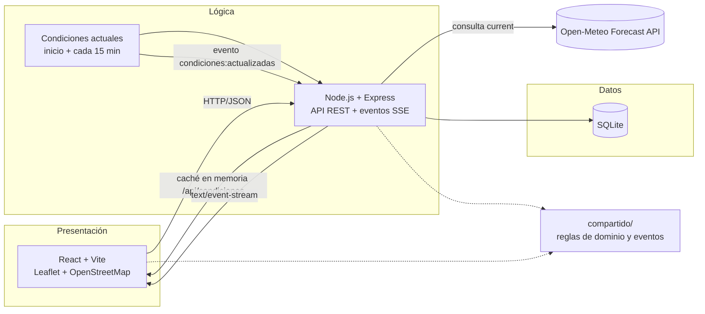

# geoAlerts

**Monitoreo, registro y visualización en tiempo real de alertas meteorológicas y marítimas de Buenos Aires y su franja costera.**

Vientos, tormentas, sudestadas y oleaje sobre un mapa interactivo: el público consulta sin registrarse y cada organismo autorizado publica y gestiona **solo sus propias alertas**, que llegan al instante a todos los navegadores abiertos. Las condiciones actuales de Open-Meteo se muestran en un banner independiente; no se convierten en alertas oficiales ni en marcadores del mapa.

---

## Documentación del proyecto

| Etapa | Documento | Contenido |
| --- | --- | --- |
| 1 | [Análisis y Factibilidad](docs/01-analisis-factibilidad.md) | Problema, alcance y microclimas · DFD · fuentes y factibilidad · alcance final actualizado para condiciones Open-Meteo y presentación en banner |
| 2 | [Diseño y Arquitectura](docs/02-diseno-arquitectura.md) | DER y modelo de datos · requisitos y casos de uso · eventos SSE · panel de detalle, bandeja inferior y endpoint de condiciones |
| 3 | [Implementación, Construcción y Testing](docs/03-implementacion-testing.md) | Estructura real · ingesta cada 15 min y caché en memoria · interfaz React/Leaflet · pruebas y resultados verificados |
| 4 | [Release, Mantenimiento y Cierre](docs/04-release-mantenimiento.md) | Manual actualizado · UAT · reversión · mantenimiento · alcance real del release y trabajo futuro |

Historial de cambios: [CHANGELOG.md](CHANGELOG.md).

## Arquitectura



## Interfaz e ingesta actuales

- Los marcadores abren un panel lateral con el detalle de la alerta; en móviles se presenta como drawer inferior.
- Filtros, acceso administrativo, publicación y lista de alertas están en una bandeja inferior plegable “Explorar el mapa”.
- El backend consulta condiciones actuales al iniciar y luego cada 15 minutos. El banner superior se actualiza por SSE y no añade alertas ni registros a SQLite.
- `GET /api/condiciones` devuelve la última lectura disponible; `GET /api/forzar-ingesta` permite solicitar una consulta manual.

## Inicio rápido

Requisitos: **Node.js 20 o superior**.

```bash
npm install        # instala backend, frontend y módulo compartido
npm run dev:backend    # API en http://localhost:3001 (crea la base y consulta condiciones actuales)
npm run dev:frontend   # en otra terminal → http://localhost:5173
```

| Usuario | Contraseña | Rol |
| --- | --- | --- |
| `admin` | `admin123` | Superadministrador (todos los organismos) |
| `defensacivil` | `demo123` | Administrador · Defensa Civil CABA (demo) |
| `tigre` | `demo123` | Administrador · Defensa Civil Tigre (demo) |

Los usuarios de demostración no se crean en producción.

### Otros comandos

```bash
npm test                # 74 pruebas de caja blanca y caja negra
npm run test:cobertura # pruebas + informe de cobertura
npm run typecheck      # verificación de tipos TypeScript (strict)
npm run build          # compila el frontend
npm start              # producción (tras npm run build): API + frontend en http://localhost:3001
npm run backup          # respaldo en caliente de la base
```

### Producción con Docker

```bash
cp infra/.env.ejemplo infra/.env   # completar DOMINIO, JWT_SECRET y ADMIN_PASSWORD
docker compose -f infra/docker-compose.yml --env-file infra/.env up -d --build
```

Detalle en la [Etapa 3, sección 3.4](docs/03-implementacion-testing.md#34-puesta-en-producción).

## API REST

| Método | Ruta | Acceso | Respuestas |
| --- | --- | --- | --- |
| GET | `/api/salud` | Público | 200 |
| POST | `/api/login` | Público | 200 · 400 · 401 |
| GET | `/api/alertas?tipo=&gravedad=&estado=` | Público | 200 · 400 |
| GET | `/api/alertas/:id` | Público | 200 · 400 · 404 |
| GET | `/api/origenes` | Público | 200 |
| GET | `/api/condiciones` | Público | 200 (puede devolver null antes de la primera lectura) |
| GET | `/api/eventos` | Público (SSE) | 200 `text/event-stream` |
| GET | `/api/forzar-ingesta` | Público | 200 · 502 |
| POST | `/api/alertas` | Token Bearer | 201 · 400 · 401 · 403 · 500 |
| PATCH | `/api/alertas/:id/estado` | Token Bearer | 200 · 400 · 401 · 403 · 404 |

Glosario completo de códigos en la [Etapa 2, sección 2.4.5](docs/02-diseno-arquitectura.md#245-glosario-de-códigos-de-respuesta-http).

## Estructura

```text
geoAlerts/
├── compartido/   reglas de dominio comunes (región, validación, permisos, tipos)
├── backend/      schema.sql · db.js · auth.js · eventos.js · server.js · services/ingesta.js · tests/
├── frontend/     React + Leaflet (App.jsx, Mapa.jsx, PanelAlerta.jsx, api.js)
├── infra/        Dockerfile · docker-compose.yml · Caddyfile
└── docs/          documentación de las Etapas 1 a 4
```

## Aviso

geoAlerts **complementa y no reemplaza** a los canales oficiales de alerta. Los organismos de demostración incluidos en los datos de prueba no representan a entidades reales. Cartografía © [OpenStreetMap](https://www.openstreetmap.org/copyright) contributors.

## Licencia

[MIT](LICENSE).