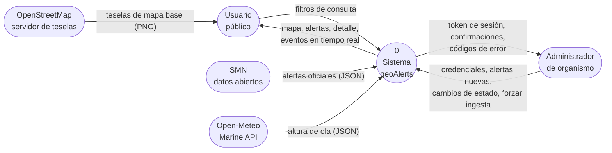
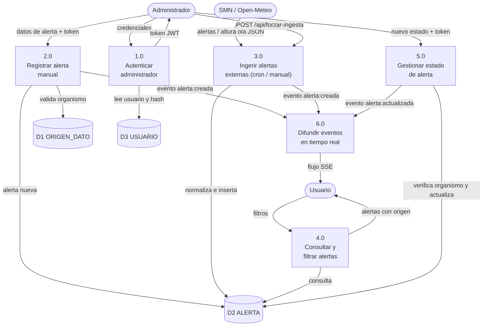
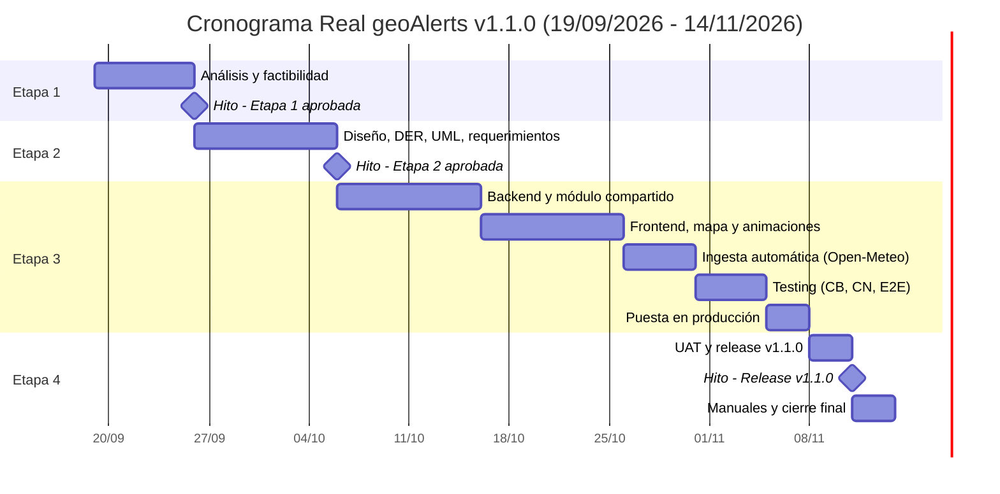
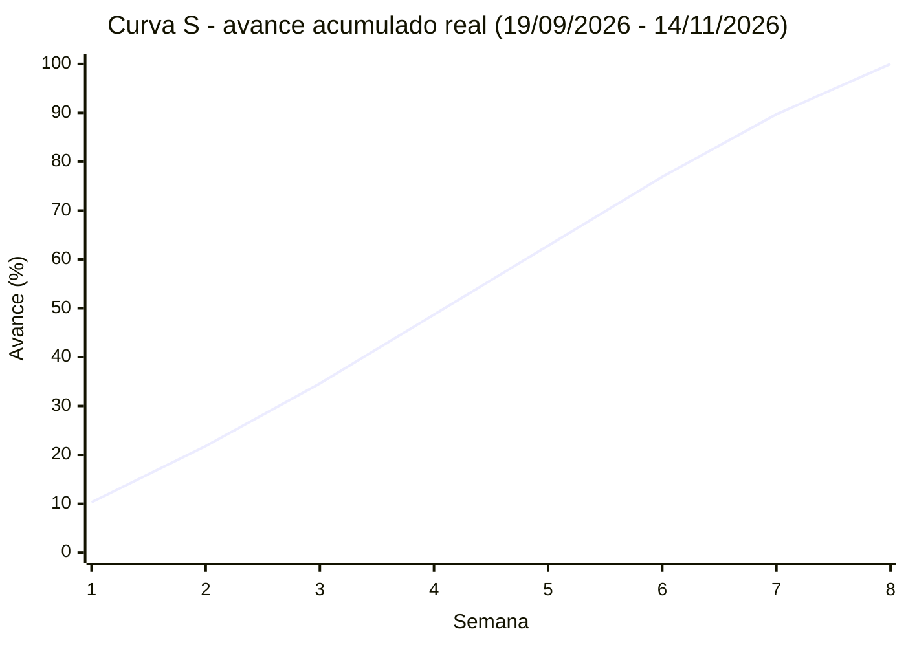
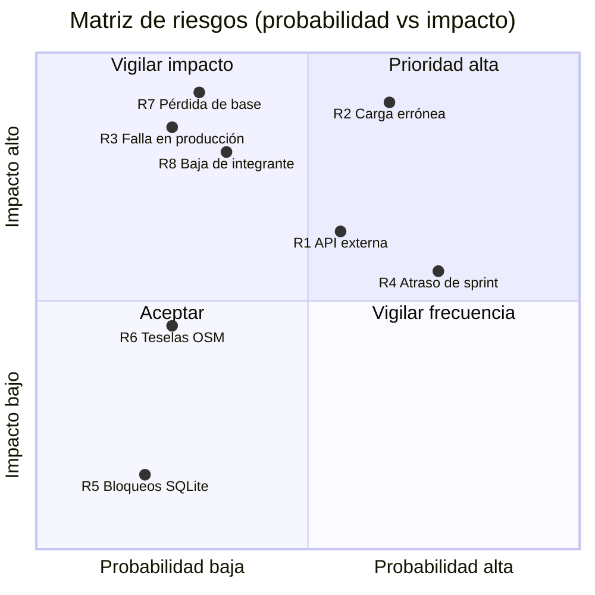

# Etapa 1 — Análisis y Factibilidad

> **Proyecto:** geoAlerts · **Versión del documento:** 1.1.0 · **Fecha:** 14/11/2026
> **Navegación:** [Índice](../README.md) · **Etapa 1** · [Etapa 2](02-diseno-arquitectura.md) · [Etapa 3](03-implementacion-testing.md) · [Etapa 4](04-release-mantenimiento.md)

## Contenido

1. [Reconocimiento del problema y objetivos](#11-reconocimiento-del-problema-y-objetivos)
2. [Alcance geográfico y justificación por microclimas](#12-alcance-geográfico-y-justificación-por-microclimas)
3. [Diagrama ambiental de contexto (DFD Nivel 0 y Nivel 1)](#13-diagrama-ambiental-de-contexto)
4. [Relevamiento de datos, fuentes y estructura inicial](#14-relevamiento-de-datos-fuentes-y-estructura-inicial)
5. [Estudio de mercado y competencia](#15-estudio-de-mercado-y-competencia)
6. [Análisis de factibilidades](#16-análisis-de-factibilidades)
7. [O.L.A. — Objetivos, Límites y Alcances](#17-ola--objetivos-límites-y-alcances)
8. [Propuesta y contrato comercial](#18-propuesta-y-contrato-comercial)
9. [Planificación estratégica](#19-planificación-estratégica)

---

## 1.1 Reconocimiento del problema y objetivos

### Situación problemática

La información sobre alertas meteorológicas y marítimas que afectan a Buenos Aires y su costa está **dispersa** en organismos oficiales, portales de pronóstico, comunicados municipales y portuarios y redes sociales. Cada fuente usa su propio formato (texto, PDF, mapa estático, publicación en redes), por lo que el vecino debe consultar varias para saber si una alerta lo afecta **en su zona**. Además:

- Los avisos **locales** (anegamientos de un barrio, crecida en el Delta, cierre de una playa) los emiten organismos municipales que no disponen de una herramienta propia para publicarlos georreferenciados.
- No existe un **historial** simple y consultable de las alertas emitidas en la región.
- Los fenómenos más disruptivos de la región, como la **sudestada** del Río de la Plata y el **oleaje** del litoral atlántico, no siempre se presentan en el mismo canal que las alertas meteorológicas generales.

### Árbol de problemas (síntesis)

| Causa | Problema central | Efecto |
| --- | --- | --- |
| Fuentes dispersas y heterogéneas | El ciudadano no puede saber rápido **qué** alerta está vigente, **dónde** y **con qué gravedad** | Decisiones tardías (circular, navegar, evacuar) |
| Avisos locales sin canal georreferenciado | | Información local que no llega a quien la necesita |
| Falta de historial | | Imposible analizar la recurrencia de eventos |

### Objetivo general

Desarrollar un sistema web que **centralice, registre y muestre en tiempo real** sobre un mapa interactivo las alertas meteorológicas y marítimas de **Buenos Aires y su franja costera**, accesible para cualquier persona y administrable por organismos autorizados.

### Objetivos específicos

| Id | Objetivo específico | Indicador de cumplimiento |
| --- | --- | --- |
| OE-1 | Visualizar alertas geolocalizadas coloreadas por gravedad | El mapa muestra el 100 % de las alertas activas de la base |
| OE-2 | Permitir filtrar por tipo, gravedad y estado | Respuesta del filtro en menos de 1 s |
| OE-3 | Difundir cambios en tiempo real | Una alerta nueva aparece en los navegadores abiertos en menos de 2 s, sin recargar |
| OE-4 | Permitir a organismos autenticados cargar y cerrar alertas | Alta completa en menos de 1 minuto |
| OE-5 | Aislar la gestión por organismo | Ningún organismo puede modificar alertas de otro (respuesta 403) |
| OE-6 | Conservar un historial consultable | Las alertas finalizadas se consultan con el filtro de estado |
| OE-7 | Automatizar la ingesta de fuentes externas de datos abiertos | El worker programado consulta Open-Meteo y emite alertas sin intervención manual |

---

## 1.2 Alcance geográfico y justificación por microclimas

**geoAlerts v1.1 cubre exclusivamente la provincia de Buenos Aires, la Ciudad Autónoma de Buenos Aires (CABA) y su franja costera** (margen argentina del Río de la Plata, Delta del Paraná y litoral marítimo atlántico). Técnicamente, la región se define como un rectángulo envolvente en coordenadas WGS84:

| Límite | Valor | Referencia aproximada |
| --- | --- | --- |
| Latitud máxima (norte) | −33,0° | Límite con Santa Fe (San Nicolás) |
| Latitud mínima (sur) | −41,2° | Límite con Río Negro (Carmen de Patagones) |
| Longitud mínima (oeste) | −63,5° | Límite con La Pampa |
| Longitud máxima (este) | −56,5° | Cabo San Antonio / Punta Rasa |

El sistema **rechaza** toda alerta con coordenadas fuera de este rectángulo, tanto en la interfaz como en la API (código 400) y en la base de datos (restricción `CHECK`).

### ¿Por qué no un alcance nacional?

Argentina abarca más de 3.700 km de norte a sur y una enorme variedad de **microclimas** y realidades territoriales. Una misma alerta, con el **mismo tipo y nivel**, tiene impactos operativos completamente distintos según dónde se emita:

| Aspecto | Misiones (noreste) | La Pampa (centro) | Buenos Aires (alcance de geoAlerts) |
| --- | --- | --- | --- |
| Clima predominante | Subtropical húmedo, sin estación seca | Semiárido a subhúmedo | Templado húmedo con influencia oceánica y estuarial |
| Precipitación anual aproximada | Más de 1.700 mm | Entre 300 y 800 mm según la zona | Alrededor de 1.000 a 1.200 mm en el noreste |
| Qué significa una **alerta amarilla por lluvias** | Lluvia frecuente; suelos y drenajes habituados; el riesgo está en crecidas de arroyos y deslizamientos | Lluvia intensa poco habitual; suelos que no infiltran rápido, caminos rurales de tierra intransitables y anegamiento de campos | Anegamiento urbano en barrios de bajo nivel y desbordes de arroyos entubados del conurbano |
| Fenómenos propios | Tormentas convectivas severas | Viento, sequía, voladuras de suelo | **Sudestada** (crecida del Río de la Plata), **oleaje** atlántico, tormentas severas en el AMBA |
| Respuesta operativa típica | Monitoreo de cauces y rutas | Asistencia a productores y caminos rurales | Cortes de tránsito, evacuación de ribera, cierre de puertos y playas |

Consecuencias de diseño:

1. **El catálogo de tipos de alerta es regional.** `SUDESTADA` solo tiene sentido en el estuario del Río de la Plata; `OLEAJE` se refiere al litoral atlántico bonaerense. Un catálogo nacional exigiría decenas de tipos (nevadas, zonda, granizo agrícola, etc.) con reglas distintas por zona.
2. **El nivel de gravedad no es comparable entre regiones** sin contexto local. Mostrar en un mismo mapa nacional una alerta amarilla en Misiones y otra en La Pampa transmitiría una **equivalencia de riesgo que no existe**.
3. **Los organismos operadores son locales** (Defensa Civil municipal, autoridades portuarias). Un MVP acotado permite validar el modelo con un conjunto manejable de organismos antes de escalar.
4. **El rectángulo envolvente es una aproximación.** Incluye pequeñas porciones de provincias vecinas y del Río de la Plata uruguayo. Ajustarlo al contorno real requiere consultas espaciales con polígonos (PostGIS), previstas como [trabajo futuro](04-release-mantenimiento.md#462-trabajo-futuro).

> La expansión a otras regiones se plantea como réplicas regionales del sistema, cada una con su propio catálogo de fenómenos, y no como un único mapa nacional.

---

## 1.3 Diagrama ambiental de contexto

### DFD Nivel 0 — Diagrama de contexto

El sistema se representa como **un único proceso** rodeado por sus agentes exógenos (entidades externas). En este nivel no se muestran almacenes internos.

| Agente exógeno | Tipo | Flujos de entrada al sistema | Flujos de salida del sistema |
| --- | --- | --- | --- |
| Usuario | Persona (anónima) | Filtros de consulta | Mapa, listado y detalle de alertas; eventos en tiempo real |
| Administrador | Persona autenticada de un organismo | Credenciales; datos de alerta; cambios de estado; ejecución manual de ingesta (`SUPERADMIN`) | Token JWT; alerta creada o actualizada; códigos HTTP de error |
| SMN (datos abiertos) | Sistema externo | Alertas oficiales por zona | — |
| Open-Meteo Marine API | Sistema externo | Pronóstico de altura de ola | — |
| OpenStreetMap | Sistema externo | — (entrega teselas directamente al navegador del Usuario) | — |

**Límites del sistema.** *Dentro:* recepción, validación, almacenamiento, ingesta automática, consulta, difusión en tiempo real y presentación de alertas; autenticación y autorización por organismo. *Fuera:* la producción del pronóstico (la realizan los organismos oficiales), la cartografía base, la difusión por canales externos (SMS, radio) y la administración del servidor.

### DFD Nivel 1 — Subsistemas

| Proceso | Descripción | Almacenes | Estado en v1.1 |
| --- | --- | --- | --- |
| 1.0 Autenticar administrador | Verifica credenciales con bcrypt y emite un token JWT de 8 h | D3 | Implementado |
| 2.0 Registrar alerta manual | Valida datos y región, fija el organismo e inserta en una transacción | D1, D2 | Implementado |
| 3.0 Ingerir alertas externas | Tarea programada (`node-cron`) y endpoint manual que consultan Open-Meteo Marine API, normalizan al formato interno e insertan con `tipo_fuente = API_EXTERNA` | D1, D2 | **Implementado en v1.1** (con respaldo de datos realistas ante indisponibilidad de red; conector SMN preparado) |
| 4.0 Consultar y filtrar | Lista alertas por tipo, gravedad y estado | D1, D2 | Implementado |
| 5.0 Gestionar estado | Activa o finaliza una alerta respetando el aislamiento por organismo | D2 | Implementado |
| 6.0 Difundir eventos | Reenvía cada evento de dominio a los navegadores suscriptos (Server-Sent Events) | — | Implementado |

---

## 1.4 Relevamiento de datos, fuentes y estructura inicial

### Técnicas de relevamiento

| Técnica | Aplicación | Hallazgo principal |
| --- | --- | --- |
| Observación | Portales de alertas oficiales y de pronóstico | Las alertas se publican por zona en texto; pocas veces con coordenadas |
| Análisis documental | Escala de alertas por colores (amarillo, naranja, rojo) | Se adopta la misma escala para no confundir al público |
| Entrevistas informales | Vecinos de zonas ribereñas (CABA, Tigre, Quilmes); personal de un club náutico | Necesidad de "ver en el mapa si me toca" y de avisos locales del Delta |
| Cuestionario breve | Potenciales operadores municipales | Requieren publicar sin conocimientos técnicos y que nadie más modifique sus avisos |

> Las entrevistas y cuestionarios son la base cualitativa del relevamiento; sus registros se adjuntan al legajo de la cátedra.

### Flujos de información relevados

1. **Ingreso manual.** El Administrador de un organismo se autentica, completa el formulario, marca la ubicación en el mapa y publica. La alerta queda asociada a su organismo (`CARGA_MANUAL`).
2. **Ingreso por API externa (implementado en v1.1).** Un proceso programado con `node-cron` (y ejecutable bajo demanda vía `POST /api/forzar-ingesta`) consulta fuentes de datos abiertos (Open-Meteo Marine API), transforma la respuesta y registra la alerta con origen `API_EXTERNA` sin duplicar avisos activos previos.
3. **Consulta.** El Usuario abre el mapa, filtra y consulta el detalle.
4. **Difusión.** Cada alta (manual o automática) o cambio de estado se reenvía al instante a todos los navegadores conectados mediante el bus de eventos y SSE.
5. **Cierre.** Cuando el fenómeno termina, el organismo dueño (o el proceso de sincronización externa) marca la alerta como `FINALIZADA`; sale de la vista por defecto pero se conserva en el historial.

### Fuentes de datos

| Fuente | Tipo | Datos que aporta | Licencia / condición de uso | Uso en v1.1 |
| --- | --- | --- | --- | --- |
| Organismos operadores (Defensa Civil, municipios) | Carga manual | Avisos locales georreferenciados | Responsabilidad del organismo que publica | Activo |
| Open-Meteo Marine API | API externa | Altura y período de ola en puntos costeros (Mar del Plata, Necochea, Bahía Blanca, Partido de la Costa) | Uso no comercial gratuito según sus términos | **Activo** (ingesta automática cada 30 min + endpoint manual) |
| SMN — datos abiertos | API externa | Alertas oficiales por zona | Datos abiertos del Estado nacional | Registrado como origen; estructura lista en `ingesta.js` |
| OpenStreetMap | Teselas de mapa base | Cartografía | ODbL (atribución obligatoria) | Activo |

### Estructura de datos inicial (planilla relevada)

Antes del sistema, un operador registraría las alertas en una planilla como la siguiente, que es el **punto de partida de la normalización** desarrollada en la [Etapa 2](02-diseno-arquitectura.md#222-normalización-hasta-3fn):

| Fecha | Fuente | Tipo de fuente | Alertas del día (título / tipo / gravedad / lat / long) | Cargado por | Clave |
| --- | --- | --- | --- | --- | --- |
| 20/10/2026 | SMN | API | Sudestada RdlP / SUDESTADA / NARANJA / −34,61 / −58,36 ; Tormentas La Plata / TORMENTA / NARANJA / −34,92 / −57,95 | — | — |
| 20/10/2026 | Defensa Civil CABA | Manual | Anegamientos Palermo / TORMENTA / ROJO / −34,58 / −58,43 | defensacivil | ******** |

---

## 1.5 Estudio de mercado y competencia

### Alternativas analizadas

| Solución | Tipo | Fortalezas | Debilidades frente al caso de uso |
| --- | --- | --- | --- |
| SMN — sistema de alerta temprana | Organismo oficial | Fuente oficial; escala de colores; cobertura nacional | No admite avisos locales de terceros; sin historial accesible; sin difusión en tiempo real orientada al mapa |
| Windy | Plataforma privada de visualización | Capas animadas de viento y oleaje; modelos globales | Muestra **pronóstico**, no alertas formales; interfaz densa para público general; funciones avanzadas pagas |
| Comunicados de Prefectura y puertos | Avisos institucionales | Información marítima autorizada | Texto plano, sin mapa ni filtros; difusión fragmentada |
| Cuentas municipales en redes sociales | Difusión informal | Inmediatez y alcance | Sin estructura, sin coordenadas, sin historial y mezclado con otros contenidos |
| Aplicaciones de clima genéricas | Producto comercial | Buena experiencia móvil | Alertas genéricas; no incluyen sudestada ni avisos municipales |

### Matriz comparativa de funcionalidades

| Funcionalidad | SMN | Windy | Avisos portuarios | Redes sociales | **geoAlerts** |
| --- | --- | --- | --- | --- | --- |
| Alertas formales por nivel | Sí | No | Parcial | No | **Sí** |
| Mapa interactivo de alertas | Parcial | Sí (pronóstico) | No | No | **Sí** |
| Avisos locales de organismos | No | No | Solo puerto | Sí, sin estructura | **Sí** |
| Sudestada y oleaje como tipos propios | Parcial | Como variables | Parcial | No | **Sí** |
| Tiempo real sin recargar | No | Sí | No | Sí | **Sí** |
| Historial consultable | No | No | No | Difícil | **Sí** |
| Costo para el usuario | Gratis | Freemium | Gratis | Gratis | **Gratis** |

### Valor diferencial del MVP

1. **Mapa de alertas, no de pronóstico:** muestra qué está vigente, dónde y con qué gravedad, sin capas técnicas.
2. **Avisos locales con dueño:** cada organismo publica y gestiona **solo** sus alertas (aislamiento multiempresa).
3. **Tiempo real por eventos:** una alerta publicada (manual o automática) aparece en los navegadores abiertos sin recargar.
4. **Trazabilidad del origen:** cada alerta indica la fuente (API externa u organismo).
5. **Especialización regional:** catálogo de fenómenos y región pensados para Buenos Aires.
6. **Costo cero en licencias y despliegue simple:** un proceso Node.js y un archivo SQLite.

**Público objetivo:** habitantes de zonas ribereñas y costeras, navegantes recreativos, clubes náuticos, áreas de Defensa Civil municipales y operadores portuarios.

---

## 1.6 Análisis de factibilidades

### 1.6.1 Factibilidad humana y operativa

**Usuarios.** El Usuario no necesita registrarse ni capacitarse: abre la página, ve el mapa y usa tres desplegables. La escala de colores es la misma que la oficial. El Administrador publica una alerta en menos de un minuto (cuatro campos y un clic en el mapa).

**Equipo de desarrollo.** Dos desarrolladores full-stack con dominio de JavaScript, lenguaje único en cliente y servidor.

**Análisis FODA**

| | Positivo | Negativo |
| --- | --- | --- |
| **Interno** | **Fortalezas** F1. Un solo lenguaje (JavaScript/TypeScript) en todas las capas F2. $0 en licencias F3. Interfaz mínima, sin curva de aprendizaje F4. Reglas de negocio compartidas entre cliente y servidor F5. Difusión en tiempo real e ingesta automática integrada | **Debilidades** D1. Equipo reducido (2 personas) D2. Conector oficial SMN pendiente de normalización geográfica (Open-Meteo ya activo) D3. SQLite admite un único escritor a la vez D4. Región rectangular aproximada |
| **Externo** | **Oportunidades** O1. Política de datos abiertos del Estado (Decreto 117/2016) O2. Recurrencia de sudestadas y tormentas severas en el AMBA O3. Municipios sin herramienta propia de avisos O4. Cartografía libre de OpenStreetMap | **Amenazas** A1. Caída o cambio de formato de APIs externas A2. Carga errónea por parte de un operador (desinformación) A3. Límites de uso del servidor de teselas de OSM A4. Percepción de competencia con canales oficiales |

**FODA cruzado (estrategias)**

| | Oportunidades | Amenazas |
| --- | --- | --- |
| **Fortalezas** | **FO (ofensivas):** usar F2+F4 para ofrecer el sistema sin costo a municipios (O3); aprovechar F5 para destacar la sudestada y el oleaje en tiempo real (O2) | **FA (defensivas):** con F4, validar en cliente y servidor para reducir cargas erróneas (A2); F2 permite cambiar de proveedor de teselas sin costos de licencia (A3) |
| **Debilidades** | **DO (adaptativas):** apoyarse en datos abiertos (O1) para ampliar los conectores automáticos (D2); migrar a PostGIS con polígonos oficiales (D4) | **DA (supervivencia):** mantener la carga manual como respaldo ante caídas de APIs (A1, D2); aislar por organismo para que un error no afecte avisos ajenos (A2); aclarar que el sistema complementa a los canales oficiales (A4) |

**Resultado:** factible.

### 1.6.2 Factibilidad técnica

| Componente | Tecnología | Justificación |
| --- | --- | --- |
| Lenguaje | JavaScript ES2022 con verificación de tipos de TypeScript (`checkJs` estricto) | Un lenguaje en todas las capas y tipado estático sin paso de compilación en el servidor |
| Backend | Node.js 20 o superior, Express 4, `node-cron` 3 | Servidor asíncrono orientado a eventos, liviano y con planificación de tareas periódicas |
| Base de datos | SQLite 3 (better-sqlite3) | Un archivo, sin servidor ni instalación; transacciones ACID |
| Frontend | React 18, Vite 5 | Interfaz por componentes; build optimizado |
| Motor cartográfico | Leaflet 1.9 y OpenStreetMap | Leaflet dibuja el mapa y OSM provee las teselas base; ambos libres y sin clave de API |
| Tiempo real | Server-Sent Events (estándar HTML) | Unidireccional servidor → cliente, nativo del navegador, sin librerías |
| Seguridad | bcrypt, JSON Web Token | Estándares abiertos y maduros |

**Requerimientos de hardware**

| Entorno | Procesador | Memoria | Almacenamiento | Software |
| --- | --- | --- | --- | --- |
| Desarrollo (por integrante) | 2 núcleos, 64 bits | 4 GB (8 GB recomendado) | 2 GB libres | Node.js 20+, Git, VS Code, navegador moderno |
| Servidor de producción | 1 vCPU | 512 MB (1 GB recomendado) | 1 GB (base + respaldos) | Linux con Docker, o Node.js 20+ |
| Cliente (Usuario) | Cualquier PC o teléfono de los últimos 5 años | 2 GB | — | Navegador actualizado; conexión de 1 Mbps o más |

**Volumen estimado:** hasta 10.000 alertas por año (unos pocos MB en SQLite), lejos de los límites del motor. Las escrituras las hacen solo los administradores y el proceso cron periódico, por lo que la restricción de un escritor a la vez no es un cuello de botella.

**Resultado:** factible.

### 1.6.3 Factibilidad económica

Valor hora de referencia: **$15.000 ARS** (supuesto para un perfil semi-senior; debe actualizarse con el valor vigente del consejo profesional de la jurisdicción).

| Concepto | Horas | Subtotal (ARS) |
| --- | --- | --- |
| Etapa 1 — Análisis y factibilidad | 32 | $480.000 |
| Etapa 2 — Diseño y arquitectura | 48 | $720.000 |
| Etapa 3 — Backend, módulo compartido e ingesta automática | 64 | $960.000 |
| Etapa 3 — Frontend, mapa y animaciones | 72 | $1.080.000 |
| Etapa 3 — Testing (caja blanca, caja negra, E2E) | 40 | $600.000 |
| Etapa 3 — Puesta en producción | 16 | $240.000 |
| Etapa 4 — UAT y release | 16 | $240.000 |
| Etapa 4 — Manuales, documentación y cierre | 24 | $360.000 |
| **Subtotal recursos humanos** | **312** | **$4.680.000** |
| Licencias de software (todo open-source) | — | $0 |
| Infraestructura de desarrollo (equipos propios) | — | $0 |
| Contingencia (10 % de RR. HH.) | — | $468.000 |
| **Total del proyecto** | **312** | **$5.148.000** |

**Costos recurrentes de operación (opcionales, fuera del MVP académico)**

| Concepto | Costo estimado | Observación |
| --- | --- | --- |
| Ejecución local o en servidor propio del organismo | $0 | Suficiente para la demostración |
| Servidor virtual básico (1 vCPU, 1 GB) | Del orden de USD 5–6 por mes | Valor de referencia de proveedores de bajo costo; verificar al contratar |
| Dominio `.com.ar` | Arancel anual de NIC Argentina | Consultar valor vigente |
| Certificado HTTPS | $0 | Let's Encrypt, automatizado con Caddy |

**Resultado:** factible a costo $0 en licencias y bajo costo de operación.

### 1.6.4 Factibilidad legal

| Norma o licencia | Alcance | Cumplimiento en geoAlerts |
| --- | --- | --- |
| **Ley 25.326** de Protección de Datos Personales | Tratamiento de datos de personas | El Usuario es anónimo: no se piden datos ni se usan cookies de seguimiento. De los administradores solo se guarda el nombre de usuario y el **hash** de la contraseña (principios de finalidad, minimización y seguridad) |
| **Ley 27.275** de Acceso a la Información Pública y **Decreto 117/2016** (Plan de Apertura de Datos) | Reutilización de datos publicados por el Estado | Solo se usan datos publicados como abiertos, citando la fuente en cada alerta |
| **Ley 11.723** de Propiedad Intelectual (software incluido por Ley 25.036) | Titularidad del código | El código propio se publica con licencia MIT; la titularidad se define en el contrato (sección 1.8) |
| **ODbL** (OpenStreetMap) | Uso de la cartografía | Atribución "© OpenStreetMap contributors" visible en el mapa |
| Licencias MIT, BSD y Apache de las dependencias; SQLite en dominio público | Uso, modificación y redistribución | Permiten uso comercial y académico sin costo |
| Licencia Hippocratic 2.1 (react-leaflet) | Uso de la integración React–Leaflet | Permite el uso libre con condiciones éticas (respeto de los derechos humanos), compatibles con el propósito del sistema. Si un cliente exigiera solo licencias aprobadas por la OSI, se reemplaza por el uso directo de Leaflet |
| Términos de uso de Open-Meteo | Uso de su API | Uso no comercial gratuito activo para datos marítimos; un uso comercial requiere plan pago |
| Responsabilidad sobre la información | Alertas de terceros | La interfaz aclara que geoAlerts **complementa y no reemplaza** a los canales oficiales; cada alerta muestra su organismo de origen |

**Resultado:** factible.

---

## 1.7 O.L.A. — Objetivos, Límites y Alcances

**Objetivo.** Centralizar y difundir en tiempo real, sobre un mapa, las alertas meteorológicas y marítimas de Buenos Aires y su franja costera, con publicación controlada por organismos autorizados e ingesta automática de datos marítimos.

**Límites (dónde empieza y dónde termina el sistema).**

- *Comienza* cuando un Administrador publica una alerta o cuando el worker automático la ingiere desde Open-Meteo Marine API.
- *Termina* cuando la alerta se muestra en el mapa del Usuario y, al cerrarse, queda en el historial.

**Alcances.**

| Incluido en v1.1 | Excluido de v1.1 |
| --- | --- |
| Mapa público con alertas por gravedad y animaciones de enfoque (`flyTo` / `fitBounds`) | Pronóstico numérico propio |
| Filtros por tipo, gravedad y estado (historial) | Notificaciones push, SMS o correo |
| Detalle con organismo de origen y fechas | Aplicación móvil nativa |
| Actualización en tiempo real (SSE) | Ingesta automática oficial de SMN (previsto v1.2) |
| Ingesta automática periódica de oleaje (Open-Meteo + `node-cron`) y ejecución manual | Alta de usuarios desde la interfaz (se hace por configuración) |
| Inicio y cierre de sesión de administradores | Polígonos de zonas afectadas (requiere PostGIS) |
| Alta manual con ubicación en el mapa, validada a la región | Cobertura fuera de Buenos Aires |
| Cambio de estado con aislamiento por organismo | Alta disponibilidad multi-servidor |
| Despliegue con Docker y respaldos | |

---

## 1.8 Propuesta y contrato comercial

### Propuesta

| Ítem | Detalle |
| --- | --- |
| Producto | geoAlerts v1.1.0 — sistema web de alertas meteorológicas y marítimas para Buenos Aires y su franja costera |
| Entregables | Código fuente (repositorio Git), base de datos con datos de prueba, imagen Docker, documentación de Etapas 1 a 4, manuales de Usuario y Administrador |
| Plazo | 8 semanas reales de ejecución (19/09/2026 al 14/11/2026) |
| Precio | $5.148.000 ARS (incluye contingencia del 10 %) |
| Forma de pago | 30 % a la firma · 40 % al aprobar la Etapa 3 · 30 % al aprobar la UAT (Etapa 4) |
| Garantía | 90 días de mantenimiento correctivo sin costo desde la puesta en producción |
| Validez de la oferta | 30 días |

### Modelo de contrato de desarrollo de software

> Modelo orientativo para el trabajo práctico. Los datos entre corchetes se completan con las partes reales; no reemplaza el asesoramiento de un profesional del derecho.

**Partes.** Entre [Equipo de desarrollo geoAlerts], en adelante "EL DESARROLLADOR", y [Organismo o cliente], en adelante "EL CLIENTE", se celebra el presente contrato sujeto a las siguientes cláusulas:

1. **Objeto.** EL DESARROLLADOR se obliga a desarrollar e implementar el sistema geoAlerts conforme al alcance definido en el O.L.A. (sección 1.7) y los requerimientos de la Etapa 2.
2. **Plazo.** 8 (ocho) semanas desde la firma (del 19/09/2026 al 14/11/2026), según el cronograma de la sección 1.9. Los atrasos causados por EL CLIENTE extienden el plazo en igual medida.
3. **Precio y forma de pago.** $5.148.000 ARS, pagaderos según los hitos de la propuesta.
4. **Aceptación.** Cada hito se considera aceptado si EL CLIENTE no formula observaciones por escrito dentro de los 5 (cinco) días hábiles de su entrega. La aceptación final se da con la aprobación de la UAT.
5. **Cambios de alcance.** Todo requerimiento nuevo se cotiza por separado mediante una solicitud de cambio firmada por ambas partes.
6. **Propiedad intelectual.** El código desarrollado se licencia bajo MIT. EL CLIENTE recibe el código fuente completo y puede usarlo, modificarlo y distribuirlo. Las bibliotecas de terceros mantienen sus licencias originales.
7. **Confidencialidad.** Las partes mantendrán en reserva credenciales, secretos de configuración y datos internos a los que accedan.
8. **Datos personales.** EL CLIENTE es responsable de la base de datos de administradores y del cumplimiento de la Ley 25.326.
9. **Garantía.** 90 días de mantenimiento correctivo sin costo. Se excluyen fallas por modificaciones de terceros o por cambios en servicios externos.
10. **Responsabilidad.** EL DESARROLLADOR no responde por el contenido de las alertas publicadas por los organismos ni por la disponibilidad de servicios de terceros (APIs y teselas).
11. **Rescisión.** Cualquiera de las partes puede rescindir con 15 días de preaviso, abonándose el trabajo aceptado hasta esa fecha.
12. **Jurisdicción.** Para cualquier controversia, las partes se someten a los tribunales ordinarios de la Ciudad Autónoma de Buenos Aires.

Firmas: ______________________ (EL DESARROLLADOR) · ______________________ (EL CLIENTE) · Lugar y fecha: ____________

---

## 1.9 Planificación estratégica

### Metodología: Scrumban (Scrum + Kanban)

- **Scrum** marca el ritmo: 4 sprints intensivos de 2 semanas entre el 19/09/2026 y el 14/11/2026, con planificación, revisión (demo al cliente o docente) y retrospectiva.
- **Kanban** organiza el trabajo diario en un tablero (GitHub Projects) con columnas **Backlog → Por hacer → En curso → En revisión → Hecho** y un límite de 2 tareas *En curso* por persona.
- **Roles:** Product Owner (prioriza el backlog), Scrum Master (facilita y remueve impedimentos), Equipo de desarrollo (2 personas full-stack).
- **Definición de Hecho:** código revisado por *pull request*, verificación de tipos sin errores, pruebas automatizadas en verde y documentación actualizada.

| Sprint | Fechas | Objetivo | Entregables |
| --- | --- | --- | --- |
| 1 | 19/09/2026 – 02/10/2026 | Análisis, factibilidad y diseño arquitectónico | Etapa 1 completa; Etapa 2 (DER, UML, requerimientos) |
| 2 | 03/10/2026 – 16/10/2026 | Backend base, módulo compartido y frontend inicial | `schema.sql`, `db.js`, `dominio.js`, `server.js`, `Mapa.jsx` |
| 3 | 17/10/2026 – 30/10/2026 | Testing integral y despliegue MVP (`v1.0.0`) | Pruebas de caja blanca, caja negra y E2E; Docker y Caddy |
| 4 | 31/10/2026 – 14/11/2026 | Ingesta automática (`v1.1.0`), UX mapa, UAT y cierre | Worker `ingesta.js` (`node-cron`), animaciones `flyTo`/`fitBounds`, manuales y entrega final |

### Cronograma (diagrama de Gantt)

Período real de desarrollo y entrega: **sábado 19 de septiembre de 2026 al sábado 14 de noviembre de 2026** (8 semanas / 56 días corridos).

**Descripción del cronograma.** El proyecto inició el **19/09/2026** con la Etapa 1 (7 días) y continuó con el diseño arquitectónico de la Etapa 2 (10 días, hasta el 05/10/2026). La construcción (Etapa 3) se desarrolló entre el 06/10/2026 y el 07/11/2026: backend y dominio compartido (10 días), interfaz cartográfica con animaciones `flyTo`/`fitBounds` (10 días), módulo de ingesta automática con `node-cron` y Open-Meteo (5 días), batería completa de pruebas automatizadas (5 días) y configuración de producción (3 días). Finalmente, entre el 08/11/2026 y el **14/11/2026** (Etapa 4) se ejecutaron las pruebas de aceptación (UAT), el release `v1.1.0`, los manuales operativos y el cierre del proyecto.

### Curva S de avance

La curva S muestra el **avance acumulado** (en horas-hombre) a lo largo de las 8 semanas reales de ejecución (del 19/09/2026 al 14/11/2026).

| Semana | Período | Actividad principal | Horas de la semana | Horas acumuladas | Avance planificado | Avance real |
| --- | --- | --- | --- | --- | --- | --- |
| 1 | 19/09 – 25/09 | Análisis y factibilidad | 32 | 32 | 10,3 % | 10,3 % |
| 2 | 26/09 – 02/10 | Diseño y arquitectura | 36 | 68 | 21,8 % | 21,8 % |
| 3 | 03/10 – 09/10 | Diseño cierre + Backend base | 40 | 108 | 34,6 % | 34,6 % |
| 4 | 10/10 – 16/10 | Backend API + SSE | 44 | 152 | 48,7 % | 48,7 % |
| 5 | 17/10 – 23/10 | Frontend y mapa interactivo | 44 | 196 | 62,8 % | 62,8 % |
| 6 | 24/10 – 30/10 | Ingesta automática + Animaciones UX | 44 | 240 | 76,9 % | 76,9 % |
| 7 | 31/10 – 06/11 | Testing (CB, CN, E2E) + Docker | 40 | 280 | 89,7 % | 89,7 % |
| 8 | 07/11 – 14/11 | UAT, manuales y release v1.1.0 | 32 | 312 | 100,0 % | 100,0 % |

**Lectura.** El ritmo de ejecución alcanzó su mayor intensidad entre las semanas 3 y 7 (construcción del backend, frontend, ingesta automática y testing), completando el 100 % de las 312 horas comprometidas el 14/11/2026 sin desvíos respecto al cronograma establecido.

### Análisis de riesgos

Escala: probabilidad e impacto de 1 (bajo) a 3 (alto); exposición = probabilidad × impacto.

| Id | Riesgo | Prob. | Impacto | Exposición | Mitigación | Contingencia |
| --- | --- | --- | --- | --- | --- | --- |
| R1 | Caída o cambio de formato de una API externa | 2 | 2 | 4 | Capa de adaptación por fuente; respaldo con datos realistas en `ingesta.js` y carga manual | Desactivar el cron o usar el modo respaldo mientras se ajusta el adaptador |
| R2 | Carga errónea de una alerta por un operador | 2 | 3 | **6** | Validación compartida cliente-servidor; restricción de región; aislamiento por organismo | El organismo finaliza la alerta errónea al instante |
| R3 | Falla en producción tras un despliegue | 1 | 3 | 3 | Pruebas automatizadas en el build; respaldo previo | [Plan de reversión](04-release-mantenimiento.md#43-plan-de-reversión-rollback) |
| R4 | Atraso de un sprint | 2 | 2 | 4 | Backlog priorizado; seguimiento con Curva S | Recortar funciones de menor valor del sprint |
| R5 | Bloqueos de escritura en SQLite | 1 | 1 | 1 | Modo WAL; `busy_timeout` de 5 s | Migración a PostgreSQL/PostGIS |
| R6 | Límite de uso de teselas OSM | 1 | 2 | 2 | Caché del navegador; tráfico bajo | Proveedor de teselas alternativo configurable |
| R7 | Pérdida del archivo de base de datos | 1 | 3 | 3 | Volumen persistente; respaldo en caliente diario | Restaurar el último respaldo |
| R8 | Baja de un integrante del equipo | 1 | 3 | 3 | Código documentado; revisión cruzada por *pull request* | Redistribuir tareas y renegociar el alcance |

---

**Siguiente:** [Etapa 2 — Diseño y Arquitectura →](02-diseno-arquitectura.md)