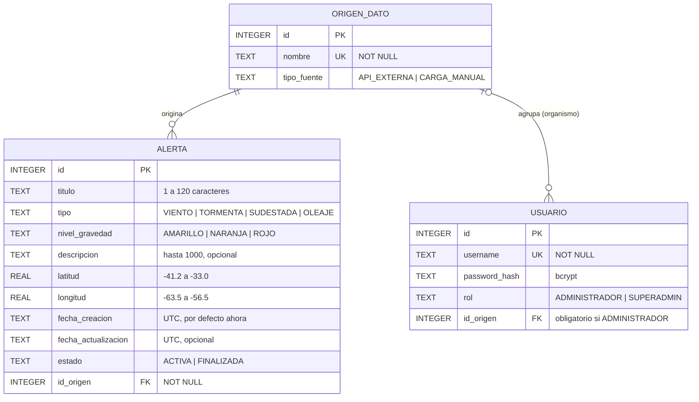
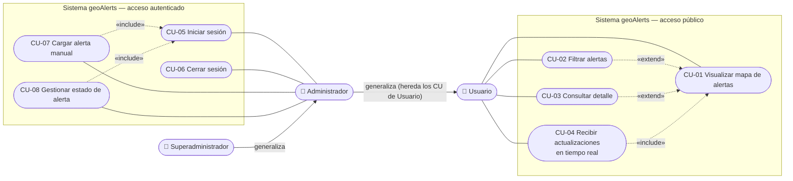
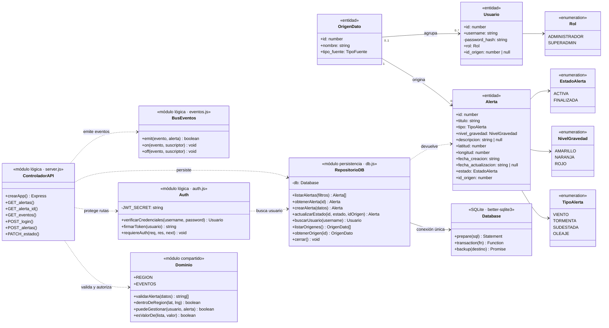
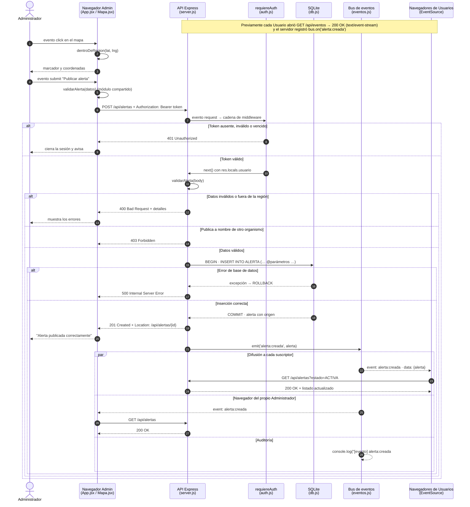
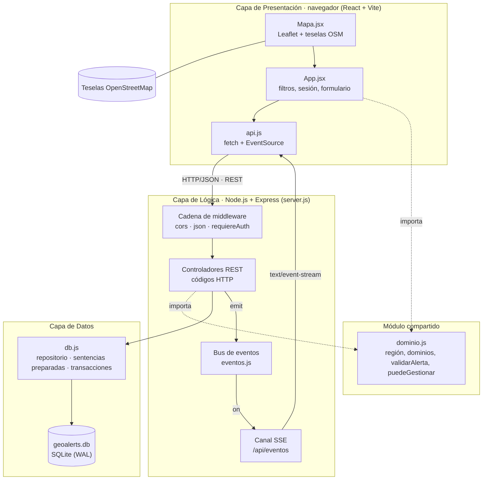
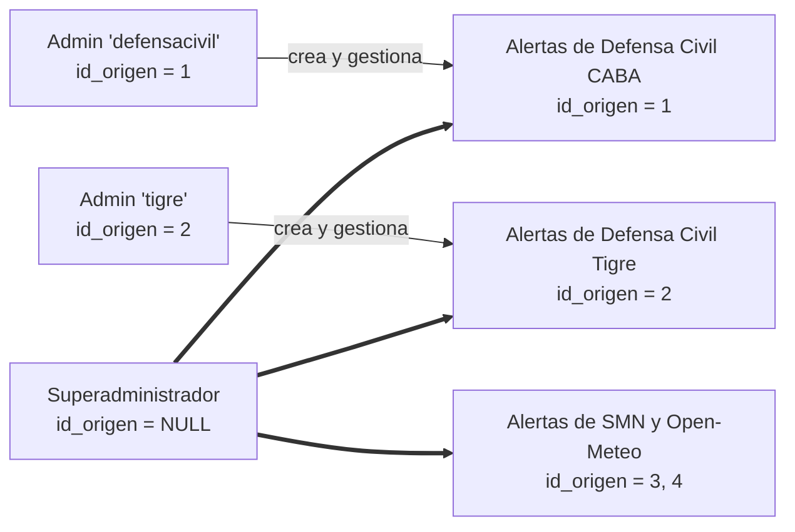
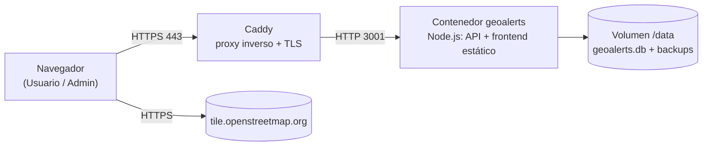

# Etapa 2 — Diseño y Arquitectura

> **Proyecto:** geoAlerts · **Versión del documento:** 1.0.0 · **Fecha:** 26/10/2026
> **Navegación:** [Índice](../README.md) · [Etapa 1](01-analisis-factibilidad.md) · **Etapa 2** · [Etapa 3](03-implementacion-testing.md) · [Etapa 4](04-release-mantenimiento.md)

## Contenido

1. [Elección tecnológica](#21-elección-tecnológica)
2. [Diseño de base de datos](#22-diseño-de-base-de-datos)
3. [Especificación de requerimientos](#23-especificación-de-requerimientos)
4. [Modelado UML](#24-modelado-uml)
5. [Arquitectura del sistema](#25-arquitectura-del-sistema)
6. [Matriz de trazabilidad SQA](#26-matriz-de-trazabilidad-sqa)

---

## 2.1 Elección tecnológica

| Categoría | Herramienta | Versión | Rol en geoAlerts | Motivo de la elección |
| --- | --- | --- | --- | --- |
| Lenguaje | **JavaScript ES2022 con TypeScript** (verificación de tipos) | TS 5.6 | Todo el código | Un solo lenguaje en todas las capas. El backend y el módulo compartido se escriben en JavaScript con anotaciones JSDoc y `// @ts-check`, y el compilador de TypeScript los verifica en modo `strict` (`npm run typecheck`). Se obtiene tipado estático sin paso de compilación en el servidor |
| Entorno de ejecución | **Node.js** | 20 o superior | Servidor | Bucle de eventos asíncrono, ideal para muchas conexiones abiertas de SSE |
| Framework backend | **Express** | 4.21 | API REST | Ruteo y cadena de middleware mínimos y conocidos |
| Base de datos (v1.0) | **SQLite 3** mediante better-sqlite3 | 11.5 | Persistencia | Un archivo, sin servidor; transacciones ACID; restricciones `CHECK` y claves foráneas |
| Base de datos (evolución) | **PostgreSQL + PostGIS** | — | Previsto para v2 | Consultas espaciales con polígonos (zonas afectadas, contorno real de la provincia). **No se usa en v1.0**: el MVP solo necesita puntos y un rectángulo, que SQLite resuelve con dos columnas `REAL` y un índice compuesto. El acceso a datos está aislado en `db.js` para que la migración no afecte a las otras capas |
| Framework frontend | **React** | 18.3 | Interfaz | Componentes y estado declarativo |
| Empaquetador | **Vite** | 5.4 | Desarrollo y build | Recarga instantánea; build de producción optimizado; proxy de `/api` en desarrollo |
| Motor cartográfico | **Leaflet + OpenStreetMap** | Leaflet 1.9 · react-leaflet 4.2 | Mapa | Trabajan juntos: **Leaflet** es la librería que dibuja el mapa en el navegador (zoom, arrastre, marcadores, popups) y **OpenStreetMap** es el proveedor de la capa base, las teselas (imágenes de 256×256 px) que Leaflet coloca como fondo. Ambos son libres y no requieren clave de API |
| Tiempo real | **Server-Sent Events** | Estándar HTML | Difusión de eventos | Canal unidireccional servidor → navegador, nativo (`EventSource`), con reconexión automática |
| Seguridad | bcryptjs · jsonwebtoken · cors | 2.4 · 9.0 · 2.8 | Autenticación y autorización | Hash de contraseñas, tokens firmados, control de orígenes |
| Pruebas | `node:test` (nativo) · Playwright | Node 22 · 1.56 | Caja blanca, caja negra, E2E | Sin dependencias extra para las pruebas unitarias y de API; navegador real para la E2E |
| Contenedores | Docker · Docker Compose · Caddy | Caddy 2.8 | Despliegue | Imagen reproducible; HTTPS automático |
| IDE | Visual Studio Code | — | Desarrollo | Extensiones ESLint, Prettier, SQLite Viewer, Mermaid Preview |
| Control de versiones | Git + GitHub | — | Repositorio y tablero | Ramas por tarea, *pull requests*, GitHub Projects (Kanban), etiquetas de versión |
| Modelado | Mermaid | — | Diagramas | Se escriben como texto en el Markdown y GitHub los dibuja automáticamente |

---

## 2.2 Diseño de base de datos

### 2.2.1 Modelo Entidad-Relación (DER)



**Entidades y relaciones**

| Relación | Cardinalidad | Participación | Significado |
| --- | --- | --- | --- |
| ORIGEN_DATO — ALERTA | 1 : N | Obligatoria del lado de ALERTA | Toda alerta proviene de exactamente una fuente; una fuente puede tener muchas alertas |
| ORIGEN_DATO — USUARIO | 1 : N | Opcional del lado de USUARIO | Cada ADMINISTRADOR pertenece a un organismo (fuente `CARGA_MANUAL`); el SUPERADMIN no pertenece a ninguno |

La entidad **ORIGEN_DATO cumple un doble rol**: identifica la fuente de una alerta y, cuando es de tipo `CARGA_MANUAL`, representa al **organismo** que la publicó. Esa es la unidad de **aislamiento multiempresa** ([sección 2.5.2](#252-aislamiento-multiempresa-por-organismo)).

### 2.2.2 Normalización hasta 3FN

**Forma no normalizada (0FN).** Se parte de la planilla relevada en la [Etapa 1](01-analisis-factibilidad.md#14-relevamiento-de-datos-fuentes-y-estructura-inicial): una fila por día y fuente con un **grupo repetitivo** de alertas, y los datos del operador mezclados con los de la alerta.

`PLANILLA(fecha, fuente, tipo_fuente, {titulo, tipo, gravedad, descripcion, latitud, longitud, estado}*, cargado_por, clave, rol)`

**Primera Forma Normal (1FN): valores atómicos, sin grupos repetitivos.** Cada alerta pasa a ser una fila, cada atributo una columna atómica (latitud y longitud separadas; la fecha completa en ISO 8601) y se agrega una clave primaria.

`ALERTA_1FN(id_alerta, titulo, tipo, nivel_gravedad, descripcion, latitud, longitud, fecha_creacion, fecha_actualizacion, estado, nombre_fuente, tipo_fuente, username, password_hash, rol, organismo_usuario)`

Anomalías que persisten:

| Anomalía | Ejemplo |
| --- | --- |
| De inserción | No se puede registrar un organismo ni un usuario que todavía no publicó alertas |
| De modificación | Si se renombra una fuente, hay que actualizar todas sus alertas; si cambia una contraseña, todas las filas del usuario |
| De borrado | Al borrar la última alerta de un usuario se pierden sus credenciales |

**Segunda Forma Normal (2FN): sin dependencias parciales.** La clave primaria es **simple** (`id_alerta`), por lo que no puede haber dependencias de una parte de la clave: la relación ya está en 2FN. Las anomalías no se resuelven porque su causa son **dependencias transitivas**.

**Tercera Forma Normal (3FN): sin dependencias transitivas.** Dependencias funcionales identificadas:

| Dependencia | Clasificación |
| --- | --- |
| `id_alerta → titulo, tipo, nivel_gravedad, descripcion, latitud, longitud, fecha_creacion, fecha_actualizacion, estado, nombre_fuente` | Directa (válida) |
| `nombre_fuente → tipo_fuente` | **Transitiva**: `id_alerta → nombre_fuente → tipo_fuente` |
| `username → password_hash, rol, organismo_usuario` | **Ajena** a la alerta: describe al usuario, no al hecho |

Se extrae cada determinante a su propia tabla con clave sustituta numérica (más estable y compacta que el texto):

1. `ORIGEN_DATO(id, nombre, tipo_fuente)`, con `nombre` como clave candidata (`UNIQUE`).
2. `ALERTA(id, titulo, tipo, nivel_gravedad, descripcion, latitud, longitud, fecha_creacion, fecha_actualizacion, estado, id_origen)`, con `id_origen` como clave foránea.
3. `USUARIO(id, username, password_hash, rol, id_origen)`, con `username` como clave candidata e `id_origen` como clave foránea al organismo.

**Verificación**

| Tabla | 1FN | 2FN | 3FN | Justificación |
| --- | --- | --- | --- | --- |
| ORIGEN_DATO | ✔ | ✔ | ✔ | `nombre` y `tipo_fuente` dependen solo de `id` |
| ALERTA | ✔ | ✔ | ✔ | Los datos de la fuente se movieron a ORIGEN_DATO; solo queda la clave foránea |
| USUARIO | ✔ | ✔ | ✔ | `password_hash`, `rol` e `id_origen` dependen solo de `id`; `username` es clave candidata |

Los dominios cerrados (`tipo`, `nivel_gravedad`, `estado`, `rol`, `tipo_fuente`) se implementan con restricciones `CHECK`. Si en el futuro se necesitara administrarlos desde la interfaz, pasarían a tablas de catálogo sin romper la 3FN.

### 2.2.3 Modelo relacional lógico

```text
ORIGEN_DATO (id PK, nombre UNIQUE NOT NULL, tipo_fuente NOT NULL)

USUARIO     (id PK, username UNIQUE NOT NULL, password_hash NOT NULL, rol NOT NULL,
             id_origen FK → ORIGEN_DATO.id NULL)
             CHECK: (rol = 'SUPERADMIN' ∧ id_origen IS NULL) ∨ (rol = 'ADMINISTRADOR' ∧ id_origen IS NOT NULL)

ALERTA      (id PK, titulo NOT NULL, tipo NOT NULL, nivel_gravedad NOT NULL, descripcion NULL,
             latitud NOT NULL, longitud NOT NULL, fecha_creacion NOT NULL, fecha_actualizacion NULL,
             estado NOT NULL, id_origen FK → ORIGEN_DATO.id NOT NULL)

Integridad referencial: ON UPDATE CASCADE · ON DELETE RESTRICT (no se puede borrar una fuente con alertas o usuarios)
Índices: ALERTA(tipo), ALERTA(nivel_gravedad), ALERTA(estado), ALERTA(id_origen), ALERTA(latitud, longitud)
```

### 2.2.4 Diccionario de datos

| Tabla | Campo | Tipo | Nulo | Restricción | Descripción |
| --- | --- | --- | --- | --- | --- |
| ORIGEN_DATO | id | INTEGER | No | PK, autoincremental | Identificador |
| ORIGEN_DATO | nombre | TEXT | No | UNIQUE | Nombre de la fuente u organismo |
| ORIGEN_DATO | tipo_fuente | TEXT | No | `API_EXTERNA`, `CARGA_MANUAL` | Clase de fuente |
| USUARIO | id | INTEGER | No | PK, autoincremental | Identificador |
| USUARIO | username | TEXT | No | UNIQUE | Nombre de acceso |
| USUARIO | password_hash | TEXT | No | — | Hash bcrypt (10 rondas); la contraseña nunca se guarda |
| USUARIO | rol | TEXT | No | `ADMINISTRADOR`, `SUPERADMIN` | Perfil de permisos |
| USUARIO | id_origen | INTEGER | Sí | FK → ORIGEN_DATO.id; obligatorio si `ADMINISTRADOR`, nulo si `SUPERADMIN` | Organismo al que pertenece |
| ALERTA | id | INTEGER | No | PK, autoincremental | Identificador |
| ALERTA | titulo | TEXT | No | Entre 1 y 120 caracteres sin espacios extremos | Título breve |
| ALERTA | tipo | TEXT | No | `VIENTO`, `TORMENTA`, `SUDESTADA`, `OLEAJE` | Fenómeno |
| ALERTA | nivel_gravedad | TEXT | No | `AMARILLO`, `NARANJA`, `ROJO` | Nivel de alerta |
| ALERTA | descripcion | TEXT | Sí | Hasta 1000 caracteres | Detalle libre |
| ALERTA | latitud | REAL | No | Entre −41,2 y −33,0 | Coordenada WGS84 dentro de la región |
| ALERTA | longitud | REAL | No | Entre −63,5 y −56,5 | Coordenada WGS84 dentro de la región |
| ALERTA | fecha_creacion | TEXT | No | Por defecto `datetime('now')` (UTC) | Fecha y hora de emisión |
| ALERTA | fecha_actualizacion | TEXT | Sí | UTC | Último cambio de estado |
| ALERTA | estado | TEXT | No | `ACTIVA`, `FINALIZADA`; por defecto `ACTIVA` | Ciclo de vida |
| ALERTA | id_origen | INTEGER | No | FK → ORIGEN_DATO.id | Fuente u organismo |

---

## 2.3 Especificación de requerimientos

### 2.3.1 Requerimientos funcionales

| Id | Requerimiento | Prioridad | Especificación técnica | Criterio de aceptación |
| --- | --- | --- | --- | --- |
| RF-01 | Mostrar el mapa de la región con las alertas | Alta | `GET /api/alertas`; Leaflet + OSM encuadrado en la región; un `CircleMarker` por alerta con color y radio según la gravedad | Se ven todas las alertas activas; el mapa abre encuadrado en Buenos Aires |
| RF-02 | Filtrar por tipo de fenómeno | Alta | Parámetro `tipo` validado contra el dominio; 400 si es inválido | Solo se muestran alertas del tipo elegido |
| RF-03 | Filtrar por nivel de gravedad | Alta | Parámetro `gravedad`; 400 si es inválido | Solo se muestran alertas del nivel elegido |
| RF-04 | Filtrar por estado y consultar el historial | Media | Parámetro `estado` (`ACTIVA`, `FINALIZADA` u omitido para todas) | Las finalizadas se ven punteadas y solo con el filtro correspondiente |
| RF-05 | Ver el detalle de una alerta | Alta | Popup con título, tipo, gravedad, descripción, organismo de origen, fecha de emisión y de actualización; `GET /api/alertas/:id` (200/400/404) | El detalle muestra el organismo de origen |
| RF-06 | Actualizar el mapa en tiempo real | Alta | `GET /api/eventos` (SSE); eventos `alerta:creada` y `alerta:actualizada`; refresco de respaldo cada 60 s | Una alerta nueva aparece en otro navegador sin recargar |
| RF-07 | Iniciar sesión como Administrador | Alta | `POST /api/login`; bcrypt; JWT HS256 de 8 h; 400/401 | Credenciales válidas habilitan el formulario de alta |
| RF-08 | Cerrar sesión | Media | Se descarta el token del `sessionStorage`; un 401 posterior cierra la sesión automáticamente | Tras "Salir" no se puede publicar |
| RF-09 | Cargar una alerta manual con ubicación tomada del mapa | Alta | `POST /api/alertas` con token; validación compartida; inserción en transacción; 201 + cabecera `Location` | La alerta queda `ACTIVA` y asociada al organismo del Administrador |
| RF-10 | Validar que la ubicación pertenezca a la región | Alta | Validación en cliente, API (400) y base (`CHECK`) | Una alerta en Misiones es rechazada |
| RF-11 | Cambiar el estado de una alerta | Media | `PATCH /api/alertas/:id/estado`; 200/400/401/403/404 | La alerta pasa a `FINALIZADA` y se registra `fecha_actualizacion` |
| RF-12 | Aislar la gestión por organismo | Alta | `puedeGestionar()` en la capa de lógica y filtro `id_origen` en el `UPDATE`; 403 | Un organismo no puede modificar ni publicar a nombre de otro |

### 2.3.2 Requerimientos no funcionales (ISO/IEC 25010)

| Id | Característica ISO/IEC 25010 | Subcaracterística | Requerimiento | Métrica y verificación |
| --- | --- | --- | --- | --- |
| RNF-01 | Adecuación funcional | Corrección | Las reglas de validación son idénticas en cliente y servidor | Un único módulo `compartido/dominio.js`; prueba CB-13 |
| RNF-02 | Eficiencia de desempeño | Comportamiento temporal | El listado responde en menos de 1 s con hasta 10.000 alertas | Índices por tipo, gravedad, estado y coordenadas |
| RNF-03 | Eficiencia de desempeño | Comportamiento temporal | Un evento llega a los navegadores conectados en menos de 2 s | SSE sin sondeo; prueba CB-12 y E2E-01 |
| RNF-04 | Compatibilidad | Interoperabilidad | API REST con JSON y códigos HTTP estándar | Glosario de códigos (sección 2.4.5) |
| RNF-05 | Usabilidad | Facilidad de aprendizaje | Un Usuario entiende el mapa sin instrucciones | Escala de colores oficial; UAT-01 |
| RNF-06 | Usabilidad | Accesibilidad | Controles con etiqueta accesible; diseño adaptable a teléfonos | `aria-label` en los campos; vista apilada en pantallas de menos de 720 px |
| RNF-07 | Fiabilidad | Tolerancia a fallos | Si el canal SSE se corta, el cliente se reconecta solo y mantiene un refresco de respaldo | `retry: 5000` y refresco cada 60 s |
| RNF-08 | Fiabilidad | Recuperabilidad | Respaldo en caliente de la base y reversión en menos de 15 minutos | `npm run backup`; plan de reversión (Etapa 4) |
| RNF-09 | Seguridad | Confidencialidad | Contraseñas con hash bcrypt; el hash nunca sale de la API | Prueba CN-07 |
| RNF-10 | Seguridad | Integridad | Sin inyección SQL; datos validados en tres capas | Consultas parametrizadas; prueba CB-10c |
| RNF-11 | Seguridad | Autenticidad y no repudio | Escrituras solo con token válido y vigente; cada alerta registra su organismo | Pruebas CB-01 a CB-05 |
| RNF-12 | Mantenibilidad | Capacidad de prueba | Cobertura de líneas superior al 85 % en el backend | 96 % obtenido (Etapa 3) |
| RNF-13 | Mantenibilidad | Modularidad | Capas desacopladas; eventos en lugar de llamadas directas entre módulos | Bus de eventos (`eventos.js`) |
| RNF-14 | Portabilidad | Instalabilidad | Puesta en marcha con 2 comandos o una imagen Docker | README; `infra/Dockerfile` |

---

## 2.4 Modelado UML

### 2.4.1 Diagrama de casos de uso

Actores:

- **Usuario:** cualquier persona que accede al sitio público, sin autenticarse.
- **Administrador:** persona autenticada que pertenece a un **organismo**. Hereda todos los casos de uso del Usuario.
- **Superadministrador:** especialización del Administrador sin organismo fijo; puede gestionar alertas de cualquier organismo.



> El Administrador también participa en CU-01 a CU-04 por **generalización**: hereda todos los casos de uso del Usuario. El Superadministrador hereda los del Administrador y no tiene la restricción de organismo en CU-07 y CU-08.

| CU | Nombre | Actor principal | Prioridad | Requerimientos |
| --- | --- | --- | --- | --- |
| CU-01 | Visualizar mapa de alertas | Usuario | Alta | RF-01 |
| CU-02 | Filtrar alertas | Usuario | Alta | RF-02, RF-03, RF-04 |
| CU-03 | Consultar detalle | Usuario | Alta | RF-05 |
| CU-04 | Recibir actualizaciones en tiempo real | Usuario | Alta | RF-06 |
| CU-05 | Iniciar sesión | Administrador | Alta | RF-07 |
| CU-06 | Cerrar sesión | Administrador | Media | RF-08 |
| CU-07 | Cargar alerta manual | Administrador | Alta | RF-09, RF-10, RF-12 |
| CU-08 | Gestionar estado de alerta | Administrador | Media | RF-11, RF-12 |

### 2.4.2 Especificación de casos de uso

En cada caso, (+) indica un paso del flujo principal exitoso y (−) una excepción con la respuesta del sistema.

#### CU-01 — Visualizar mapa de alertas

| Campo | Detalle |
| --- | --- |
| Actor | Usuario (también Administrador) |
| Propósito | Conocer qué alertas están vigentes en la región, dónde y con qué gravedad |
| Precondición | Ninguna (acceso público) |
| Postcondición | El mapa muestra un marcador por alerta activa y el Usuario queda suscripto a eventos |

**Flujo principal**

1. (+) El Usuario ingresa a la URL de geoAlerts.
2. (+) El sistema dibuja el mapa encuadrado en la región, con la capa base de OpenStreetMap y el contorno de cobertura.
3. (+) El sistema solicita `GET /api/alertas?estado=ACTIVA` y recibe **200 OK**.
4. (+) El sistema dibuja un círculo por alerta, coloreado y dimensionado según la gravedad, y actualiza el contador.
5. (+) El sistema abre la suscripción a `GET /api/eventos` (incluye CU-04) y muestra "Actualización en vivo".

**Excepciones**

- (−) E1, en el paso 3: no hay conexión con el servidor. Se muestra "No se pudieron cargar las alertas" y se reintenta en el siguiente ciclo de 60 s.
- (−) E2, en el paso 4: no hay alertas activas. El mapa se ve sin marcadores y el contador indica 0.
- (−) E3, en el paso 2: no cargan las teselas de OSM. Los marcadores se dibujan igual sobre fondo gris.

#### CU-02 — Filtrar alertas

| Campo | Detalle |
| --- | --- |
| Actor | Usuario |
| Propósito | Ver solo las alertas de interés o el historial |
| Precondición | CU-01 en ejecución |
| Postcondición | El mapa muestra solo las alertas que cumplen todos los filtros |

**Flujo principal**

1. (+) El Usuario elige tipo, gravedad o estado (Activas, Finalizadas, Todas).
2. (+) El evento `change` del desplegable dispara `GET /api/alertas?tipo=…&gravedad=…&estado=…`.
3. (+) El sistema valida los parámetros y responde **200 OK**.
4. (+) El mapa y el contador se redibujan.

**Excepciones**

- (−) E1, en el paso 4: ninguna alerta cumple el filtro. El contador indica 0.
- (−) E2, en el paso 3: un parámetro tiene un valor fuera del dominio (URL manipulada). El sistema responde **400 Bad Request** con el detalle.

#### CU-03 — Consultar detalle

| Campo | Detalle |
| --- | --- |
| Actor | Usuario |
| Propósito | Conocer la descripción, el origen y las fechas de una alerta |
| Precondición | La alerta está visible en el mapa |
| Postcondición | Se muestra el popup de detalle |

**Flujo principal**

1. (+) El Usuario hace clic sobre un marcador.
2. (+) El sistema abre un popup con título, gravedad, tipo, estado, descripción, organismo de origen, fecha de emisión y, si existe, fecha de actualización, en hora de Buenos Aires.

**Excepciones**

- (−) E1: consulta directa a `GET /api/alertas/:id` con un id inexistente. **404 Not Found**.
- (−) E2: id no numérico o menor que 1. **400 Bad Request**.

#### CU-04 — Recibir actualizaciones en tiempo real

| Campo | Detalle |
| --- | --- |
| Actor | Usuario |
| Propósito | Ver altas y cambios sin recargar la página |
| Precondición | CU-01 abrió la suscripción `EventSource` |
| Postcondición | El mapa refleja el cambio |

**Flujo principal**

1. (+) Un Administrador publica o modifica una alerta (CU-07 o CU-08).
2. (+) El servidor emite el evento de dominio en el bus y lo reenvía por SSE a todos los suscriptos.
3. (+) El navegador recibe `alerta:creada` o `alerta:actualizada` y vuelve a consultar el listado con los filtros vigentes.

**Excepciones**

- (−) E1: se corta la conexión. El indicador pasa a "Reconectando…"; el navegador reintenta a los 5 s y el refresco de respaldo cada 60 s garantiza la consistencia.
- (−) E2: el Usuario cierra la pestaña. El servidor detecta el evento `close` y elimina la suscripción.

#### CU-05 — Iniciar sesión

| Campo | Detalle |
| --- | --- |
| Actor | Administrador |
| Propósito | Obtener permisos de escritura para su organismo |
| Precondición | El usuario existe en `USUARIO` |
| Postcondición | El cliente guarda un token JWT válido por 8 h y muestra el formulario de alta con el nombre del organismo |

**Flujo principal**

1. (+) El Administrador ingresa usuario y contraseña y presiona "Ingresar".
2. (+) El evento `submit` envía `POST /api/login`.
3. (+) El servidor busca el usuario y compara la contraseña con `password_hash` mediante bcrypt.
4. (+) El servidor firma un token con id, usuario, rol y organismo y responde **200 OK** (sin el hash).
5. (+) El cliente guarda la sesión y habilita las funciones de Administrador.

**Excepciones**

- (−) E1, en el paso 2: campos vacíos o JSON malformado. **400 Bad Request**.
- (−) E2, en el paso 3: usuario inexistente o contraseña incorrecta. **401 Unauthorized** con el mismo mensaje en ambos casos y tiempo de respuesta equivalente, para no revelar qué usuarios existen.

#### CU-06 — Cerrar sesión

| Campo | Detalle |
| --- | --- |
| Actor | Administrador |
| Propósito | Finalizar la sesión en el dispositivo |
| Precondición | Sesión iniciada |
| Postcondición | El token se elimina del navegador y se ocultan las funciones de Administrador |

**Flujo principal**

1. (+) El Administrador presiona "Salir".
2. (+) El cliente borra el token del `sessionStorage` y limpia el formulario.

**Excepciones**

- (−) E1: el token vence durante el uso. La siguiente escritura recibe **401 Unauthorized** y el cliente cierra la sesión automáticamente con el aviso "La sesión venció".

#### CU-07 — Cargar alerta manual

| Campo | Detalle |
| --- | --- |
| Actor | Administrador |
| Propósito | Publicar una alerta local georreferenciada a nombre de su organismo |
| Precondición | Sesión iniciada (incluye CU-05) |
| Postcondición | La alerta queda `ACTIVA`, asociada al organismo, y aparece en todos los mapas abiertos |

**Flujo principal**

1. (+) El Administrador completa título, tipo, gravedad y descripción. El Superadministrador además puede elegir el organismo.
2. (+) El Administrador hace clic en el mapa; el sistema verifica que el punto esté en la región y coloca un marcador.
3. (+) El Administrador presiona "Publicar alerta"; el cliente valida con las mismas reglas que el servidor.
4. (+) El cliente envía `POST /api/alertas` con el token.
5. (+) El servidor verifica el token, valida los datos, fija el organismo e inserta la alerta en una transacción.
6. (+) El servidor responde **201 Created** con la alerta y la cabecera `Location`, y emite `alerta:creada`.
7. (+) El cliente muestra "Alerta publicada correctamente" y el mapa se actualiza por el evento.

**Excepciones**

- (−) E1, en el paso 2: clic fuera de la región. Se muestra el aviso y no se toma la ubicación.
- (−) E2, en el paso 3: no se marcó la ubicación o un dato es inválido. Se muestra el error y no se envía.
- (−) E3, en el paso 5: token ausente, inválido o vencido. **401 Unauthorized**; el cliente cierra la sesión.
- (−) E4, en el paso 5: datos inválidos (título, tipo, gravedad, coordenadas fuera de la región) o, para el Superadministrador, un organismo que no es de carga manual. **400 Bad Request** con la lista de errores.
- (−) E5, en el paso 5: un Administrador intenta publicar a nombre de otro organismo. **403 Forbidden**.
- (−) E6, en el paso 5: error de base de datos. La transacción se revierte y se responde **500 Internal Server Error**.

#### CU-08 — Gestionar estado de alerta

| Campo | Detalle |
| --- | --- |
| Actor | Administrador |
| Propósito | Finalizar una alerta cuando el fenómeno terminó, o reactivarla |
| Precondición | Sesión iniciada (incluye CU-05); la alerta pertenece a su organismo (o el actor es Superadministrador) |
| Postcondición | El estado cambia, se registra `fecha_actualizacion` y todos los mapas se actualizan |

**Flujo principal**

1. (+) El Administrador abre el popup de una alerta de su organismo; el sistema muestra el botón solo si tiene permiso.
2. (+) El Administrador presiona "Marcar como finalizada" (o "Reactivar").
3. (+) El cliente envía `PATCH /api/alertas/:id/estado` con el token.
4. (+) El servidor verifica el token, la existencia de la alerta y la pertenencia al organismo, y actualiza en una transacción.
5. (+) El servidor responde **200 OK** y emite `alerta:actualizada`.

**Excepciones**

- (−) E1, en el paso 4: estado fuera del dominio o id inválido. **400 Bad Request**.
- (−) E2, en el paso 4: la alerta no existe. **404 Not Found**.
- (−) E3, en el paso 4: la alerta es de otro organismo o de una API externa. **403 Forbidden**; no se modifica nada ni se emiten eventos.
- (−) E4, en el paso 4: token vencido. **401 Unauthorized**.

### 2.4.3 Diagrama de clases (dominio y persistencia)

El backend se organiza en **módulos** de JavaScript. Cada módulo se modela como una clase con estereotipo que indica su capa; sus funciones exportadas son los métodos públicos. Las entidades de dominio se definen como tipos (`@typedef`) en `compartido/dominio.js` y TypeScript las verifica.



| Clase o módulo | Capa | Responsabilidad | Archivo |
| --- | --- | --- | --- |
| Alerta, OrigenDato, Usuario y enumeraciones | Dominio | Estructura y dominios válidos de los datos | `compartido/dominio.js` (tipos) y `backend/schema.sql` (tablas) |
| Dominio | Compartida | Reglas de negocio idénticas en cliente y servidor | `compartido/dominio.js` |
| RepositorioDB | Persistencia | Consultas parametrizadas, transacciones, conexión única | `backend/db.js` |
| Auth | Lógica | bcrypt, emisión y verificación de JWT | `backend/auth.js` |
| BusEventos | Lógica | Publicación y suscripción de eventos de dominio | `backend/eventos.js` |
| ControladorAPI | Lógica | Rutas REST, códigos HTTP, canal SSE | `backend/server.js` |

### 2.4.4 Diagrama de secuencia (DSS) orientado a eventos — "Cargar alerta manual"

En la **Programación Orientada a Eventos** el flujo no lo dirige una secuencia fija de llamadas, sino la ocurrencia de eventos y los manejadores suscriptos a ellos. En geoAlerts intervienen tres niveles de eventos:

| Nivel | Evento | Productor | Manejador (suscriptor) |
| --- | --- | --- | --- |
| Interfaz | `click` en el mapa, `submit` del formulario | Navegador del Administrador | `seleccionarPunto()`, `guardarAlerta()` en `App.jsx` |
| Red | `request` HTTP | Node.js | Cadena de Express: `express.json` → `requiereAuth` → controlador |
| Dominio | `alerta:creada` | Controlador `POST /api/alertas` | Canal SSE de cada navegador conectado y auditoría en el log |



### 2.4.5 Glosario de códigos de respuesta HTTP

| Código | Nombre | Significado en geoAlerts | Endpoints que lo devuelven |
| --- | --- | --- | --- |
| **200** | OK | Consulta o modificación exitosa; en `/api/eventos` abre el flujo SSE | `GET /api/salud`, `POST /api/login`, `GET /api/alertas`, `GET /api/alertas/:id`, `GET /api/origenes`, `GET /api/eventos`, `PATCH /api/alertas/:id/estado` |
| **201** | Created | Alerta creada; incluye la cabecera `Location` con su URL | `POST /api/alertas` |
| **400** | Bad Request | Datos o parámetros inválidos: campos vacíos, valores fuera de dominio, coordenadas fuera de la región, id no numérico, JSON malformado | `POST /api/login`, `GET /api/alertas`, `GET /api/alertas/:id`, `POST /api/alertas`, `PATCH /api/alertas/:id/estado` |
| **401** | Unauthorized | Credenciales incorrectas, o token ausente, inválido o vencido | `POST /api/login`, `POST /api/alertas`, `PATCH /api/alertas/:id/estado` |
| **403** | Forbidden | Autenticado pero sin permiso: la alerta u organismo pertenece a otro | `POST /api/alertas`, `PATCH /api/alertas/:id/estado` |
| **404** | Not Found | Alerta o ruta inexistente | `GET /api/alertas/:id`, `PATCH /api/alertas/:id/estado`, cualquier ruta `/api` desconocida |
| **413** | Payload Too Large | Cuerpo de la petición mayor a 20 KB | Todas las rutas con cuerpo |
| **500** | Internal Server Error | Error no controlado; la transacción se revierte y no se exponen detalles internos | `POST /api/alertas` y manejador global |

Todas las respuestas de error tienen el formato `{ "error": "mensaje", "detalles": ["…"] }` (`detalles` solo en errores de validación).

---

## 2.5 Arquitectura del sistema

### 2.5.1 Arquitectura en tres capas



| Capa | Responsabilidad | No puede |
| --- | --- | --- |
| Presentación | Mostrar el mapa y los formularios; validar antes de enviar; reaccionar a eventos | Acceder a la base de datos ni decidir permisos (solo oculta botones; la decisión final es del servidor) |
| Lógica | Autenticar, autorizar, validar, coordinar transacciones, emitir eventos | Generar HTML ni conocer la estructura física del archivo de base |
| Datos | Persistir con integridad (FK, `CHECK`, transacciones) | Conocer HTTP ni la interfaz |

### 2.5.2 Aislamiento multiempresa (por organismo)

geoAlerts es **multiempresa** (*multi-tenant*): varios organismos comparten una misma instancia y una misma base, pero **cada uno solo gestiona sus propias alertas**. Se usa el modelo de **base compartida con discriminador de inquilino**, donde el discriminador es `id_origen`.



Las flechas finas son los permisos de cada Administrador sobre su organismo; las gruesas, los del Superadministrador sobre todas las alertas. Cualquier combinación que **no** figura como flecha (por ejemplo, `tigre` sobre una alerta de CABA, o un administrador sobre una alerta del SMN) responde **403 Forbidden**. Todas las alertas siguen siendo visibles para todos.

El aislamiento se aplica en **cuatro barreras** (defensa en profundidad):

| Barrera | Capa | Mecanismo |
| --- | --- | --- |
| 1. Token | Lógica | El JWT lleva `id_origen` firmado: el cliente no puede alterarlo |
| 2. Regla de negocio | Lógica | `puedeGestionar(usuario, alerta)` devuelve 403 si los organismos no coinciden |
| 3. Alta forzada | Lógica | En `POST /api/alertas`, el organismo de un ADMINISTRADOR se toma del token, nunca del cuerpo; si el cuerpo pide otro, 403 |
| 4. Consulta SQL | Datos | `UPDATE … WHERE id = @id AND (@id_origen IS NULL OR id_origen = @id_origen)`: aunque fallaran las barreras anteriores, la base no modifica filas ajenas |

La **lectura** es pública para todos (el propósito del sistema es difundir), por lo que el aislamiento aplica solo a las **escrituras**.

### 2.5.3 Vista de despliegue



---

## 2.6 Matriz de trazabilidad SQA

Relaciona cada requerimiento funcional con su caso de uso, las tablas y endpoints que lo implementan y las pruebas que lo verifican. Los identificadores de prueba corresponden a los nombres de los casos en `backend/tests/` y a los escenarios de la [Etapa 3](03-implementacion-testing.md#33-testing-de-código) y la [Etapa 4](04-release-mantenimiento.md#42-pruebas-de-aceptación-uat).

| Req. | Caso de uso | Tablas | Endpoint | Componente | Pruebas | Estado |
| --- | --- | --- | --- | --- | --- | --- |
| RF-01 | CU-01 | ALERTA, ORIGEN_DATO | `GET /api/alertas` | `Mapa.jsx`, `db.listarAlertas` | CN-08, E2E-01, UAT-01 | ✔ Verificado |
| RF-02 | CU-02 | ALERTA | `GET /api/alertas?tipo=` | `App.jsx`, `server.js` | CN-08, UAT-02 | ✔ Verificado |
| RF-03 | CU-02 | ALERTA | `GET /api/alertas?gravedad=` | `App.jsx`, `server.js` | CN-08, E2E-01, UAT-02 | ✔ Verificado |
| RF-04 | CU-02 | ALERTA | `GET /api/alertas?estado=` | `App.jsx`, `server.js` | CN-08, UAT-03 | ✔ Verificado |
| RF-05 | CU-03 | ALERTA, ORIGEN_DATO | `GET /api/alertas/:id` | `Mapa.jsx` (popup) | CN-08, UAT-03 | ✔ Verificado |
| RF-06 | CU-04 | — | `GET /api/eventos` | `eventos.js`, `server.js`, `App.jsx` | CB-11, CB-12, CB-12b, E2E-01, UAT-04 | ✔ Verificado |
| RF-07 | CU-05 | USUARIO, ORIGEN_DATO | `POST /api/login` | `auth.js` | CN-07, CB-01 a CB-05, E2E-01, UAT-05 | ✔ Verificado |
| RF-08 | CU-06 | — | — (cliente) | `App.jsx` | UAT-05 | ◐ Verificación manual en UAT |
| RF-09 | CU-07 | ALERTA, ORIGEN_DATO | `POST /api/alertas` | `server.js`, `db.crearAlerta` | CN-04 a CN-06, CB-10, CB-10c, E2E-01, UAT-06 | ✔ Verificado |
| RF-10 | CU-07 | ALERTA | `POST /api/alertas` | `dominio.validarAlerta`, `CHECK` | CN-01 a CN-03, CB-10b, E2E-01, UAT-06 | ✔ Verificado |
| RF-11 | CU-08 | ALERTA | `PATCH /api/alertas/:id/estado` | `server.js`, `db.actualizarEstado` | CN-09, CB-06, CB-07, UAT-07 | ✔ Verificado |
| RF-12 | CU-07, CU-08 | USUARIO, ALERTA, ORIGEN_DATO | `POST /api/alertas`, `PATCH …/estado` | `dominio.puedeGestionar`, `db.actualizarEstado` | CB-06 a CB-09c, CB-12b, UAT-08 | ✔ Verificado |

**Cobertura de la matriz:** 12 de 12 requerimientos tienen al menos una prueba asociada; 11 se verifican con pruebas automatizadas y 1 (RF-08, comportamiento exclusivo del cliente) con un escenario de aceptación manual.

---

**Anterior:** [← Etapa 1](01-analisis-factibilidad.md) · **Siguiente:** [Etapa 3 — Implementación, Construcción y Testing →](03-implementacion-testing.md)
