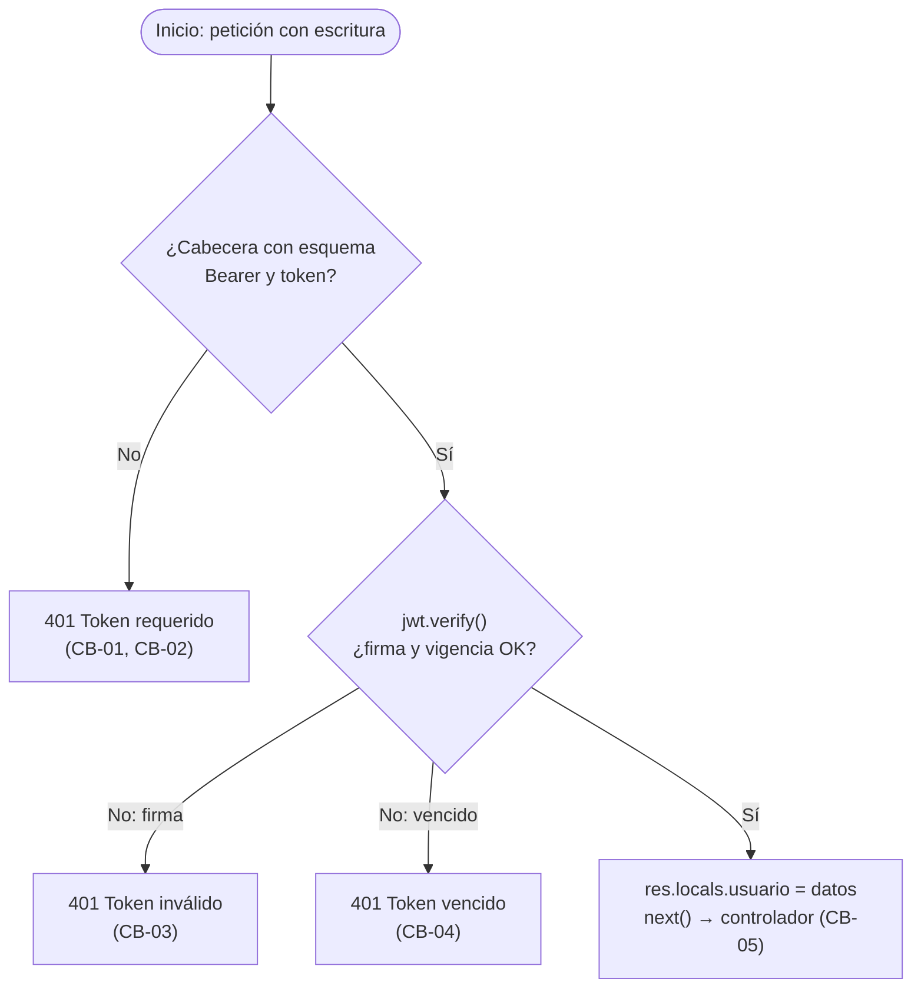

# Etapa 3 — Implementación, Construcción y Testing

> **Proyecto:** geoAlerts · **Versión del documento:** 1.1.0 · **Fecha:** 14/11/2026
> **Navegación:** [Índice](../README.md) · [Etapa 1](01-analisis-factibilidad.md) · [Etapa 2](02-diseno-arquitectura.md) · **Etapa 3** · [Etapa 4](04-release-mantenimiento.md)

## Contenido

1. [Preparación del entorno](#31-preparación-del-entorno)
2. [Construcción por módulos y estándares](#32-construcción-por-módulos-y-estándares)
3. [Testing de código](#33-testing-de-código)
4. [Puesta en producción](#34-puesta-en-producción)

---

## 3.1 Preparación del entorno

### 3.1.1 Estructura de carpetas

El repositorio es un **monorepo** con *npm workspaces*: un solo `npm install` en la raíz instala todo, y el módulo `compartido` se enlaza en el backend y en el frontend.

```text
geoAlerts/
├── package.json             # raíz: workspaces, scripts globales, TypeScript
├── package-lock.json        # versiones exactas de TODO el árbol de dependencias
├── tsconfig.json            # verificación de tipos estricta (checkJs)
├── README.md · CHANGELOG.md · LICENSE
│
├── compartido/              # reglas de dominio usadas por backend Y frontend
│   ├── package.json         # @geoalerts/compartido
│   └── dominio.js           # región, dominios, validarAlerta(), puedeGestionar(), tipos
│
├── backend/                 # Capa de Lógica + Capa de Datos
│   ├── package.json         # @geoalerts/backend
│   ├── schema.sql           # tablas, CHECK, índices y datos de prueba de Buenos Aires
│   ├── db.js                # conexión única, sentencias preparadas, transacciones
│   ├── auth.js              # bcrypt + JWT + middleware requiereAuth
│   ├── eventos.js           # bus de eventos de dominio (EventEmitter)
│   ├── ingesta.js           # worker automático (node-cron + Open-Meteo Marine API)
│   ├── server.js            # API REST orientada a eventos + canal SSE + /api/forzar-ingesta
│   ├── scripts/backup.js    # respaldo en caliente de la base
│   └── tests/               # caja blanca y caja negra (node:test)
│
├── frontend/                # Capa de Presentación
│   ├── package.json         # @geoalerts/frontend
│   ├── vite.config.js       # proxy /api → backend en desarrollo
│   ├── index.html
│   ├── e2e/recorrido.e2e.mjs  # prueba extremo a extremo en navegador real
│   └── src/
│       ├── main.jsx · styles.css
│       ├── App.jsx          # filtros, sesión, formulario, suscripción SSE, botón ingesta
│       ├── Mapa.jsx         # Leaflet + OpenStreetMap, marcadores, popups, flyTo / fitBounds
│       └── api.js           # cliente HTTP y EventSource
│
├── infra/                   # despliegue
│   ├── Dockerfile           # imagen de producción en dos etapas
│   ├── docker-compose.yml   # app + Caddy (HTTPS)
│   ├── Caddyfile            # proxy inverso con soporte SSE
│   └── .env.ejemplo         # variables a completar (secretos)
│
└── docs/                    # documentación de las Etapas 1 a 4
```

### 3.1.2 Requisitos y comandos

Requisitos: **Node.js 20 o superior** (probado con 22.22) y npm 10 o superior.

| Objetivo | Comando (desde la raíz) |
| --- | --- |
| Instalar dependencias de todos los módulos | `npm install` |
| Levantar el backend en desarrollo (puerto 3001, recarga automática) | `npm run dev:backend` |
| Levantar el frontend en desarrollo (puerto 5173) | `npm run dev:frontend` |
| Verificar tipos (TypeScript estricto) | `npm run typecheck` |
| Ejecutar las pruebas | `npm test` |
| Ejecutar las pruebas con informe de cobertura | `npm run test:cobertura` |
| Compilar el frontend para producción | `npm run build` |
| Ejecutar en modo producción (API + frontend en un proceso) | `npm start` |
| Respaldar la base de datos | `npm run backup` |
| Regenerar la base con los datos iniciales | `npm run reset-db -w @geoalerts/backend` |

Usuarios de demostración (solo fuera de producción):

| Usuario | Contraseña | Rol | Organismo |
| --- | --- | --- | --- |
| `admin` | `admin123` | SUPERADMIN | — (todos + ingesta manual) |
| `defensacivil` | `demo123` | ADMINISTRADOR | Defensa Civil CABA (demo) |
| `tigre` | `demo123` | ADMINISTRADOR | Defensa Civil Tigre (demo) |

### 3.1.3 Variables de entorno

| Variable | Por defecto | Obligatoria en producción | Uso |
| --- | --- | --- | --- |
| `PORT` | `3001` | No | Puerto HTTP |
| `DB_PATH` | `backend/geoalerts.db` | No (en Docker: `/data/geoalerts.db`) | Archivo SQLite; `:memory:` para pruebas |
| `JWT_SECRET` | Valor de desarrollo | **Sí** (el servidor no arranca sin ella) | Clave de firma de los tokens |
| `ADMIN_USER` / `ADMIN_PASSWORD` | `admin` / `admin123` | **Sí** la contraseña | Superadministrador inicial |
| `CORS_ORIGIN` | Cualquier origen | Recomendada | Dominio autorizado a llamar a la API |
| `NODE_ENV` | — | `production` | Desactiva usuarios demo y exige secretos |
| `BACKUP_DIR` | `backups/` junto a la base | No | Carpeta de respaldos |
| `INGESTA_CRON` | `*/30 * * * *` (cada 30 min) | No | Expresión cron del worker automático (`ingesta.js`); desactivable en tests |

### 3.1.4 Control de versiones de dependencias

- **Versiones exactas** en todos los `package.json` (sin `^` ni `~`): una instalación hoy y dentro de un año resuelven las mismas versiones directas.
- **`package-lock.json` versionado:** fija también las dependencias transitivas. En integración continua y en Docker se usa `npm ci`, que instala exactamente lo del lockfile y falla si no coincide con los `package.json`.
- **Versionado semántico del producto** (MAJOR.MINOR.PATCH): v1.0.0 fue el MVP inicial; v1.1.0 incorpora la ingesta automática con `node-cron`/Open-Meteo y las animaciones dinámicas del mapa (`flyTo`/`fitBounds`).
- **Git:** rama `main` protegida; ramas `feature/…` y `fix/…` por tarea; integración por *pull request* con revisión y pruebas en verde; cada release se marca con una etiqueta (`v1.0.0`, `v1.1.0`) que permite la reversión.
- **Actualizaciones:** `npm outdated` y `npm audit` mensuales (ver [mantenimiento preventivo](04-release-mantenimiento.md#45-plan-de-mantenimiento)).

| Dependencia | Versión | Módulo | Licencia |
| --- | --- | --- | --- |
| express | 4.21.1 | backend | MIT |
| better-sqlite3 | 11.5.0 | backend | MIT |
| bcryptjs | 2.4.3 | backend | MIT |
| jsonwebtoken | 9.0.2 | backend | MIT |
| cors | 2.8.5 | backend | MIT |
| node-cron | 3.0.3 | backend | ISC |
| react / react-dom | 18.3.1 | frontend | MIT |
| leaflet | 1.9.4 | frontend | BSD-2-Clause |
| react-leaflet | 4.2.1 | frontend | Hippocratic-2.1 |
| vite | 5.4.10 | frontend (desarrollo) | MIT |
| @vitejs/plugin-react | 4.3.3 | frontend (desarrollo) | MIT |
| typescript | 5.6.3 | raíz (desarrollo) | Apache-2.0 |

> **Nota de licencia:** react-leaflet usa la licencia Hippocratic 2.1, que permite el uso libre pero agrega condiciones éticas (derechos humanos). Es compatible con el propósito de geoAlerts; si un cliente exigiera solo licencias OSI, se puede reemplazar por el uso directo de Leaflet.

---

## 3.2 Construcción por módulos y estándares

### 3.2.1 Orden de construcción

| Orden | Módulo | Depende de | Verificación al terminar |
| --- | --- | --- | --- |
| 1 | `compartido/dominio.js` | — | CB-13, CB-09c |
| 2 | `backend/schema.sql` + `db.js` | 1 | CB-10, CB-10b |
| 3 | `backend/auth.js` | 2 | CB-01 a CB-05, CN-07 |
| 4 | `backend/eventos.js` | 1 | CB-11 |
| 5 | `backend/ingesta.js` | 1, 2, 4 | CB-14, CN-10 |
| 6 | `backend/server.js` | 1 a 5 | CN-01 a CN-10, CB-06 a CB-14 |
| 7 | `frontend/src/api.js` + `Mapa.jsx` + `App.jsx` | 1, 6 | Build de Vite sin errores; E2E-01 |
| 8 | `infra/` | 6, 7 | Arranque en modo producción; `/api/salud` → 200 |

### 3.2.2 Pautas de código limpio

| Pauta | Aplicación en geoAlerts |
| --- | --- |
| Nombres expresivos en español, consistentes con el dominio | `validarAlerta`, `puedeGestionar`, `crearAlerta`, `ejecutarIngesta`, `REGION`, `EVENTOS.ALERTA_CREADA` |
| Funciones cortas con una sola responsabilidad | `parsearId`, `dentroDeRegion`, `aNumero`, `verificarCredenciales`, `clasificarOleaje` |
| No repetir reglas (DRY) | Las validaciones viven **solo** en `compartido/dominio.js` y las usan cliente, servidor e ingesta |
| Retorno temprano | Cada controlador responde y hace `return` ante el primer error, sin anidar `if` |
| Sin "números mágicos" | Límites en constantes: `TITULO_MAX`, `DESCRIPCION_MAX`, `REGION`, `LATIDO_SSE_MS`, `UMBRALES_OLEAJE` |
| Comentarios que explican el **por qué** | Por qué no hay pool de conexiones; por qué el hash ficticio en el login; por qué `X-Accel-Buffering` |
| Errores sin filtrar detalles internos | El 500 devuelve un mensaje genérico; el detalle va al log del servidor |
| Configuración fuera del código | Secretos, rutas y expresión cron por variables de entorno |

### 3.2.3 Tipado estricto

El backend y el módulo compartido son JavaScript estándar (se ejecutan sin compilar) pero llevan `// @ts-check` y anotaciones JSDoc. El compilador de TypeScript los verifica con `strict: true`:

```js
// compartido/dominio.js — los tipos se derivan de las constantes (fuente única)
export const TIPOS_ALERTA = /** @type {const} */ (['VIENTO', 'TORMENTA', 'SUDESTADA', 'OLEAJE']);
/** @typedef {typeof TIPOS_ALERTA[number]} TipoAlerta */  // 'VIENTO' | 'TORMENTA' | ...

/**
 * @param {Pick<UsuarioSesion, 'rol' | 'id_origen'> | null | undefined} usuario
 * @param {Pick<Alerta, 'id_origen'>} alerta
 */
export function puedeGestionar(usuario, alerta) { /* ... */ }
```

Resultado de `npm run typecheck`: **0 errores** sobre los archivos verificados (`compartido/dominio.js`; `backend/db.js`, `auth.js`, `eventos.js`, `ingesta.js`, `server.js`, `scripts/backup.js`; y los archivos de `backend/tests/`).

### 3.2.4 Transacciones SQL y consultas parametrizadas

**Consultas parametrizadas.** Ningún dato que envía el usuario se concatena en el SQL. Los valores viajan como parámetros (`?` o `@nombre`) y el motor los trata siempre como datos, nunca como código:

```js
// backend/db.js
insertarAlerta: db.prepare(`
  INSERT INTO ALERTA (titulo, tipo, nivel_gravedad, descripcion, latitud, longitud, id_origen)
  VALUES (@titulo, @tipo, @nivel_gravedad, @descripcion, @latitud, @longitud, @id_origen)`),
```

En el único SQL dinámico (filtros del listado), los **nombres de columna** salen de una lista blanca fija del código y los **valores** siguen siendo parámetros:

```js
const columnas = [['a.tipo', filtros.tipo], ['a.nivel_gravedad', filtros.gravedad], ['a.estado', filtros.estado]];
const activas = columnas.filter(([, valor]) => valor);
const where = activas.length ? ` WHERE ${activas.map(([col]) => `${col} = ?`).join(' AND ')}` : '';
return db.prepare(`${SELECT_ALERTA}${where} ORDER BY ...`).all(...activas.map(([, v]) => v));
```

La prueba **CB-10c** envía el título `x'); DROP TABLE ALERTA; --`: se guarda como texto literal y la tabla sigue intacta.

**Transacciones.** El alta (manual o por ingesta automática) y el cambio de estado se ejecutan dentro de `db.transaction()`: si cualquier sentencia falla, SQLite revierte todas (ROLLBACK) y no quedan datos a medias.

```js
export const crearAlerta = db.transaction((datos) => {
  const info = sql.insertarAlerta.run(datos);
  return sql.alertaPorId.get(info.lastInsertRowid);  // relectura con el JOIN al origen
});
```

**Conexión y "pool".** better-sqlite3 es síncrono y SQLite admite un único escritor, por lo que un pool de N conexiones no mejora el rendimiento y agrega riesgo de bloqueos. Se usa una **conexión única por proceso** con **sentencias preparadas cacheadas**, que cumple la función del pool (reutilizar recursos costosos). Se configuran `foreign_keys = ON`, `journal_mode = WAL` (los lectores no bloquean al escritor) y `busy_timeout = 5000`. Si en el futuro se migra a PostgreSQL/PostGIS, ahí sí corresponde un pool (`pg.Pool`), y el cambio queda encapsulado en `db.js`.

### 3.2.5 Servidor orientado a eventos, ingesta automática y UX cartográfica

**Bus de eventos y SSE (`server.js` + `eventos.js`).**

```js
// backend/server.js — el controlador solo EMITE; no sabe quién escucha
res.status(201).location(`/api/alertas/${alerta.id}`).json(alerta);
bus.emit(EVENTOS.ALERTA_CREADA, alerta);

// Canal SSE — cada navegador conectado SE SUSCRIBE y se da de baja al cerrar
bus.on(EVENTOS.ALERTA_CREADA, alCrear);
req.on('close', () => { clearInterval(latido); bus.off(EVENTOS.ALERTA_CREADA, alCrear); /* … */ });
```

**Ingesta automática (`backend/ingesta.js`).** El worker utiliza `node-cron` para ejecutar periódicamente `ejecutarIngesta()` (y también puede invocarse manualmente por un `SUPERADMIN` mediante `POST /api/forzar-ingesta`). Consulta los puntos costeros monitoreados en Open-Meteo Marine API, clasifica la altura de ola (`wave_height`) en niveles de gravedad (`AMARILLO`, `NARANJA`, `ROJO`), evita duplicados activos para el mismo punto y origen, inserta las alertas nuevas en transacción y emite `EVENTOS.ALERTA_CREADA` en el bus para que todos los mapas conectados se actualicen en tiempo real. Si la API externa no está disponible, aplica un fallback controlado para garantizar continuidad.

**Animaciones dinámicas en Leaflet (`frontend/src/Mapa.jsx`).** Se incorporó un controlador de vista (`ControladorVistaMapa`) sobre `useMap()` que utiliza `map.flyTo([lat, lng], 11, { duration: 1.2 })` cuando el usuario selecciona una alerta específica (desde el listado o al abrir su detalle) y `map.fitBounds(bounds, { padding: [40, 40], maxZoom: 10 })` cuando cambian los filtros activos, logrando transiciones fluidas sin saltos bruscos de cámara.

Otros eventos que gestiona el servidor: las señales `SIGINT` y `SIGTERM` del sistema operativo disparan un **apagado ordenado** (detiene la tarea cron, deja de aceptar conexiones, corta los flujos SSE y cierra la base).

---

## 3.3 Testing de código

### 3.3.1 Estrategia

| Nivel | Técnica | Herramienta | Ubicación | Casos |
| --- | --- | --- | --- | --- |
| Unitario e integración (lógica interna) | **Caja blanca**: caminos lógicos, ramas, transacciones, ingesta y suscripciones | `node:test` + `assert` | `backend/tests/caja-blanca.test.js` | 20 |
| Integración de API | **Caja negra**: partición de equivalencias y valores límite | `node:test` + `fetch` | `backend/tests/caja-negra.test.js` | 55 |
| Extremo a extremo | Recorrido funcional en navegador real | Playwright (Chromium) | `frontend/e2e/recorrido.e2e.mjs` | 1 escenario, 7 verificaciones |
| Aceptación | Escenarios con usuarios reales | Manual | [Etapa 4](04-release-mantenimiento.md#42-pruebas-de-aceptación-uat) | 9 |

Cada archivo de prueba levanta la API en un puerto libre sobre una base **SQLite en memoria** creada desde `schema.sql`, por lo que las pruebas son aisladas, repetibles y no tocan la base real.

### 3.3.2 Casos de caja blanca

**Grafo de caminos del middleware `requiereAuth`**



Complejidad ciclomática del middleware: V(G) = 3 (2 decisiones + 1), es decir, 3 caminos independientes; los 5 casos cubren los 3 caminos y además distinguen las dos causas de falla de la verificación.

| Id | Componente | Camino o condición | Entrada | Resultado esperado | Resultado obtenido |
| --- | --- | --- | --- | --- | --- |
| CB-01 | `requiereAuth` | Sin cabecera | POST sin `Authorization` | 401 | ✔ 401 |
| CB-02 | `requiereAuth` | Esquema distinto de Bearer | `Basic <token>` | 401 | ✔ 401 |
| CB-03 | `requiereAuth` | Rama catch por firma inválida | Token firmado con otra clave | 401 | ✔ 401 |
| CB-04 | `requiereAuth` | Rama catch por vencimiento | Token con `exp` 60 s en el pasado | 401 | ✔ 401 |
| CB-05 | `requiereAuth` | Rama `next()` | Token válido | 201 | ✔ 201 |
| CB-06 | Aislamiento | SUPERADMIN, cualquier organismo | PATCH alerta del organismo 2 | 200 | ✔ 200 |
| CB-07 | Aislamiento | ADMINISTRADOR, organismo propio | `defensacivil` sobre alerta del organismo 1 | 200 | ✔ 200 |
| CB-08 | Aislamiento | ADMINISTRADOR, organismo ajeno | `tigre` sobre alerta del organismo 1 | 403 y estado sin cambios | ✔ 403, sin cambios |
| CB-08b | Aislamiento | ADMINISTRADOR sobre fuente API | `defensacivil` sobre alerta del SMN/Open-Meteo | 403 | ✔ 403 |
| CB-09 | Alta con organismo forzado | Rama ADMINISTRADOR | Sin `id_origen` / con `id_origen` ajeno | 201 con su organismo / 403 | ✔ 201 (id_origen 2) / 403 |
| CB-09b | Alta del SUPERADMIN | Rama SUPERADMIN con origen | Origen API / origen manual | 400 / 201 | ✔ 400 / 201 |
| CB-09c | `puedeGestionar()` | Tabla de decisión (5 combinaciones) | Sin usuario, SUPERADMIN, propio, ajeno, admin sin organismo | F, V, V, F, F | ✔ |
| CB-10 | `crearAlerta` (transacción) | Fallo por clave foránea | `id_origen = 999` | Excepción y 0 filas nuevas (ROLLBACK) | ✔ |
| CB-10b | `CHECK` de la base | Inserción directa fuera de la región | Coordenadas de Posadas | Excepción CHECK | ✔ |
| CB-10c | Consultas parametrizadas | Intento de inyección SQL | Título `x'); DROP TABLE ALERTA; --` | 201, texto literal, tabla intacta | ✔ |
| CB-11 | Bus de eventos | Emisión tras el alta | POST válido | El bus recibe `alerta:creada` con el mismo id | ✔ |
| CB-12 | Suscripción SSE | Alta, entrega y baja del suscriptor | Conexión a `/api/eventos` + POST + desconexión | 200 `text/event-stream`; evento recibido; suscriptores vuelven al valor inicial | ✔ |
| CB-12b | Suscripción | Operación rechazada | PATCH con 403 | Ningún evento emitido | ✔ |
| CB-13 | `validarAlerta()` | Todas las ramas | Válida, vacía, descripción no texto, latitud booleana, descripción nula | Mensajes por rama | ✔ |
| CB-14 | `ejecutarIngesta()` | Deduplicación y emisión de eventos | Ejecución doble consecutiva | Primera inserta y emite `alerta:creada`; segunda omite duplicadas | ✔ |

> **Sobre la "validación de suscripciones":** en geoAlerts las suscripciones son las de los navegadores al canal de eventos en tiempo real. Se valida su ciclo de vida completo: la suscripción se registra al conectar (CB-12), recibe los eventos (CB-11, CB-12, CB-14), no recibe eventos de operaciones fallidas (CB-12b) y se elimina al desconectar, sin fugas de memoria (CB-12).

### 3.3.3 Casos de caja negra

**Partición en clases de equivalencia**

| Entrada | Clases válidas | Clases inválidas |
| --- | --- | --- |
| Latitud | [−41,2 ; −33,0] | < −41,2 · > −33,0 · no numérica · ausente · vacía |
| Longitud | [−63,5 ; −56,5] | < −63,5 · > −56,5 |
| Título | 1 a 120 caracteres | vacío · solo espacios · > 120 · tipo no texto |
| Tipo | VIENTO, TORMENTA, SUDESTADA, OLEAJE | otro valor · minúsculas |
| Gravedad | AMARILLO, NARANJA, ROJO | otro valor |
| Descripción | ausente o 0 a 1000 caracteres | > 1000 · tipo no texto |
| Credenciales | par correcto | contraseña errónea · usuario inexistente · vacías · JSON malformado |
| Id de alerta | entero ≥ 1 existente | inexistente · no numérico · 0 |
| Filtros | valores del dominio | valor fuera del dominio |
| Estado | ACTIVA, FINALIZADA | otro valor |
| Endpoint ingesta | token con rol `SUPERADMIN` | sin token · token de `ADMINISTRADOR` |

**Análisis de valores límite**

| Id | Entrada | Valor | Clase | Esperado | Obtenido |
| --- | --- | --- | --- | --- | --- |
| CN-01 | Latitud | −41,2001 | Inválida (bajo el mínimo) | 400 | ✔ 400 |
| CN-01 | Latitud | −41,2 | Válida (mínimo) | 201 | ✔ 201 |
| CN-01 | Latitud | −41,1999 | Válida | 201 | ✔ 201 |
| CN-01 | Latitud | −37,1 | Válida (nominal) | 201 | ✔ 201 |
| CN-01 | Latitud | −33,0001 | Válida | 201 | ✔ 201 |
| CN-01 | Latitud | −33,0 | Válida (máximo) | 201 | ✔ 201 |
| CN-01 | Latitud | −32,9999 | Inválida (sobre el máximo) | 400 | ✔ 400 |
| CN-02 | Longitud | −63,5001 · −63,5 · −60,0 · −56,5 · −56,4999 | Inv. · Vál. · Vál. · Vál. · Inv. | 400 · 201 · 201 · 201 · 400 | ✔ |
| CN-03 | Coordenadas | Posadas, Misiones (−27,37; −55,90) | Inválida (otra región) | 400 "fuera de la región" | ✔ |
| CN-03 | Latitud | `"abc"` · ausente · `""` | Inválidas | 400 | ✔ |
| CN-03 | Latitud | `"-34.6"` (texto numérico) | Válida (se normaliza) | 201 | ✔ |
| CN-04 | Título | `""` · `"   "` · 121 caracteres · `123` | Inválidas | 400 | ✔ |
| CN-04 | Título | 1 carácter · 120 caracteres | Válidas (límites) | 201 | ✔ |
| CN-05 | Tipo | los 4 válidos / `NIEVE` / `viento` | Vál. / Inv. / Inv. | 201 / 400 / 400 | ✔ |
| CN-05 | Gravedad | los 3 válidos / `VERDE` | Vál. / Inv. | 201 / 400 | ✔ |
| CN-06 | Descripción | 1000 / 1001 caracteres | Vál. / Inv. | 201 / 400 | ✔ |
| CN-07 | Login | correcto · contraseña errónea · usuario inexistente · vacío · JSON malformado | — | 200 (sin hash) · 401 · 401 (mismo mensaje) · 400 · 400 | ✔ |
| CN-08 | Consulta | sin filtros · `gravedad=ROJO` · `estado=FINALIZADA` · `tipo=OLEAJE&gravedad=NARANJA` · `tipo=NIEVE` | — | 200 · 200 · 200 · 200 · 400 | ✔ |
| CN-08 | Detalle | id 1 · 99999 · `abc` · 0 · ruta inexistente | — | 200 · 404 · 400 · 400 · 404 | ✔ |
| CN-09 | Estado | `FINALIZADA` · `BORRADA` · alerta inexistente | — | 200 · 400 · 404 | ✔ |
| CN-10 | Forzar ingesta | sin token · admin común · `SUPERADMIN` | Inv. · Inv. · Vál. | 401 · 403 · 200 | ✔ |

### 3.3.4 Prueba extremo a extremo (E2E-01)

Ejecutada en **Chromium** (Playwright 1.56) contra el backend sirviendo el frontend compilado, sobre una base nueva con los usuarios de demostración:

| Paso | Acción | Verificación | Resultado |
| --- | --- | --- | --- |
| 1 | Abrir el mapa | Indicador "Actualización en vivo"; contador en 8 alertas activas | ✔ |
| 2 | Filtrar gravedad ROJO | Contador en 1; transición suave de vista | ✔ |
| 3 | Abrir un segundo navegador como Usuario público | Suscripto a eventos | ✔ |
| 4 | Iniciar sesión como `tigre` | Se muestra "Defensa Civil Tigre (demo)" | ✔ |
| 5 | Clic fuera de la región | Aviso "debe estar dentro de la región de cobertura" | ✔ |
| 6 | Publicar una alerta de sudestada en el centro de la región | "Alerta publicada correctamente" | ✔ |
| 7 | Observar el segundo navegador sin recargar | El contador pasa de 8 a 9 por el evento SSE | ✔ |
| — | Consola del navegador | Sin errores de JavaScript | ✔ |

### 3.3.5 Resultados

Ejecución de cierre `v1.1.0` (05/11/2026) con Node.js 22.22 (`npm run test:cobertura`):

```text
ℹ tests 75
ℹ suites 15
ℹ pass 75
ℹ fail 0
```

| Archivo | Líneas | Ramas | Funciones | Observación |
| --- | --- | --- | --- | --- |
| `compartido/dominio.js` | 100 % | 100 % | 100 % | |
| `backend/auth.js` | 100 % | 87,5 % | 100 % | |
| `backend/db.js` | 97,7 % | 69,6 % | 85,7 % | No cubierto: `listarOrigenes` y `cerrar`, que se ejercitan en el uso real y el apagado |
| `backend/ingesta.js` | 91,4 % | 82,0 % | 90,0 % | Cubre consulta externa, fallback, deduplicación y emisión de eventos |
| `backend/server.js` | 88,5 % | 82,1 % | 65,0 % | No cubierto: arranque y apagado del proceso, servido de archivos estáticos y ramas 413/500 |
| `backend/eventos.js` | 80,8 % | 50 % | 0 % | El suscriptor de auditoría se desactiva a propósito durante las pruebas |
| **Total** | **95,8 %** | **89,9 %** | **90,1 %** | Supera el objetivo de RNF-12 (85 % de líneas) |

Además: `npm run typecheck` → 0 errores; `npm run build` → frontend compilado sin advertencias.

---

## 3.4 Puesta en producción

### 3.4.1 Opciones de despliegue

SQLite guarda los datos en un **archivo**, por lo que el entorno debe ofrecer **almacenamiento persistente**. No sirven plataformas *serverless* ni contenedores con disco efímero.

| Opción | Descripción | Ventaja | Consideración |
| --- | --- | --- | --- |
| **A. Servidor virtual (VPS) con Docker Compose** (recomendada) | Imagen de geoAlerts + Caddy con HTTPS automático | Control total, costo bajo y predecible | Requiere administrar el servidor |
| B. PaaS con contenedores y disco persistente | Se despliega `infra/Dockerfile` montando un volumen en `/data` | Sin administrar el sistema operativo | Verificar que el plan incluya disco persistente |
| C. Servidor del organismo (on-premise) | `npm ci && npm run build && npm start` con un gestor de procesos | Datos dentro del organismo | HTTPS a cargo del área de sistemas |

### 3.4.2 Procedimiento — opción A (VPS)

1. **Preparar el servidor.** Linux con 1 vCPU y 1 GB de RAM; instalar Docker y el complemento Compose; abrir los puertos 80 y 443; apuntar el registro DNS `A` del dominio a la IP del servidor.
2. **Obtener el código de la versión a desplegar.**
   ```bash
   git clone https://github.com/<organizacion>/geoAlerts.git && cd geoAlerts
   git checkout v1.1.0
   ```
3. **Configurar secretos.**
   ```bash
   cp infra/.env.ejemplo infra/.env
   node -e "console.log(require('crypto').randomBytes(48).toString('hex'))"   # → JWT_SECRET
   nano infra/.env    # DOMINIO, JWT_SECRET, ADMIN_PASSWORD
   ```
4. **Construir y levantar.** El Dockerfile ejecuta `typecheck` y `npm test` durante la construcción: **si una prueba falla, la imagen no se genera**.
   ```bash
   docker compose -f infra/docker-compose.yml --env-file infra/.env up -d --build
   ```
5. **Verificar.**
   ```bash
   curl https://<dominio>/api/salud          # {"estado":"ok","version":"1.1.0"}
   docker compose -f infra/docker-compose.yml ps   # estado "healthy"
   ```
   Abrir el sitio, iniciar sesión con el superadministrador, probar la sincronización externa y publicar una alerta de prueba; finalizarla.
6. **Programar respaldos diarios** (cron del servidor):
   ```bash
   0 3 * * * docker compose -f /ruta/geoAlerts/infra/docker-compose.yml exec -T geoalerts node backend/scripts/backup.js
   ```
7. **Crear los administradores de cada organismo.** En v1.1 se hace por configuración (alta del organismo en `ORIGEN_DATO` y del usuario con hash bcrypt); la pantalla de gestión de usuarios está prevista como trabajo futuro.

### 3.4.3 Lista de control previa a la salida

- [x] `JWT_SECRET` aleatorio de 48 bytes o más y `ADMIN_PASSWORD` robusta configurados.
- [x] `NODE_ENV=production` (lo fija el Dockerfile): sin usuarios de demostración.
- [x] HTTPS activo y redirección desde HTTP (Caddy).
- [x] Volumen `/data` persistente y respaldo diario programado.
- [x] `/api/salud` responde 200 y el contenedor figura como `healthy`.
- [x] Tarea `node-cron` de ingesta automática operativa y verificada.
- [x] Atribución de OpenStreetMap visible en el mapa.
- [x] Leyenda "complementa y no reemplaza a los canales oficiales" visible.
- [x] Etiqueta `v1.1.0` creada en el repositorio.

---

**Anterior:** [← Etapa 2](02-diseno-arquitectura.md) · **Siguiente:** [Etapa 4 — Release, Mantenimiento y Cierre →](04-release-mantenimiento.md)