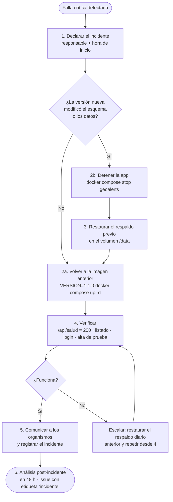

# Etapa 4 — Release, Mantenimiento y Cierre

> **Proyecto:** geoAlerts · **Versión del documento:** 1.1.0 · **Fecha:** 14/11/2026
> **Navegación:** [Índice](../README.md) · [Etapa 1](01-analisis-factibilidad.md) · [Etapa 2](02-diseno-arquitectura.md) · [Etapa 3](03-implementacion-testing.md) · **Etapa 4**

## Contenido

1. [Release y notas de versión](#41-release-y-notas-de-versión)
2. [Pruebas de aceptación (UAT)](#42-pruebas-de-aceptación-uat)
3. [Plan de reversión (rollback)](#43-plan-de-reversión-rollback)
4. [Manuales](#44-manuales)
5. [Plan de mantenimiento](#45-plan-de-mantenimiento)
6. [Anexos y cierre](#46-anexos-y-cierre)

---

## 4.1 Release y notas de versión

### geoAlerts v1.1.0 — Release Final

| Campo | Valor |
| --- | --- |
| Versión | 1.1.0 (versionado semántico) |
| Etiqueta Git | `v1.1.0` |
| Imagen Docker | `geoalerts:1.1.0` |
| Región | Buenos Aires y franja costera |
| Requisito de ejecución | Node.js 20 o superior, o Docker |
| Calidad | 75/75 pruebas automatizadas aprobadas · cobertura de líneas 95,8 % · 0 errores de tipos · E2E en Chromium y UAT aprobadas |

**Funcionalidades incluidas**

- Mapa interactivo (Leaflet + OpenStreetMap) encuadrado en la región, con el contorno de cobertura y **transiciones dinámicas suaves (`flyTo` y `fitBounds`)** al filtrar o seleccionar alertas.
- Alertas de viento, tormenta, sudestada y oleaje en tres niveles de gravedad (amarillo, naranja, rojo).
- **Ingesta automática de datos externos** (`backend/ingesta.js`) programada con `node-cron` contra **Open-Meteo Marine API** (con fallback de continuidad ante fallos de red) y ejecución manual bajo demanda vía `POST /api/forzar-ingesta` para el superadministrador.
- Filtros por tipo, gravedad y estado, incluido el historial de alertas finalizadas.
- Detalle con organismo de origen y fechas de emisión y actualización en hora de Buenos Aires.
- **Actualización en tiempo real** por Server-Sent Events, con indicador "en vivo" y reconexión automática.
- Inicio y cierre de sesión de administradores (bcrypt + JWT de 8 h).
- Alta manual de alertas con ubicación tomada del mapa y validación de región en tres capas.
- Cambio de estado (activa ↔ finalizada).
- **Aislamiento multiempresa por organismo** con superadministrador global.
- API REST con códigos HTTP estándar y errores en JSON.
- Imagen Docker, Compose con HTTPS (Caddy), respaldo en caliente de la base y apagado ordenado.

**Limitaciones conocidas**

| Id | Limitación | Alternativa o plan |
| --- | --- | --- |
| LC-01 | La región es un rectángulo y abarca pequeñas zonas fuera de la provincia | Polígono real con PostGIS (v2) |
| LC-02 | La ingesta automática está activa para Open-Meteo Marine API; el conector oficial del SMN queda preparado en `ingesta.js` | v1.2 |
| LC-03 | Los administradores se crean por configuración, no desde la interfaz | Pantalla de gestión de usuarios (v1.2) |
| LC-04 | No hay registro de qué usuario creó cada alerta, solo de qué organismo | Columna `id_usuario` en ALERTA (v1.2) |
| LC-05 | Sin notificaciones fuera del navegador abierto (push, correo) | Nuevos suscriptores del bus de eventos (v2) |
| LC-06 | Sin límite de intentos de inicio de sesión | Limitador de tasa por IP (v1.1.x) |

El historial completo de cambios está en [`CHANGELOG.md`](../CHANGELOG.md).

---

## 4.2 Pruebas de aceptación (UAT)

### 4.2.1 Planificación

| Ítem | Detalle |
| --- | --- |
| Entorno | Servidor de *staging* idéntico al de producción, con los datos de prueba de `schema.sql` |
| Participantes | 3 Usuarios (vecinos de zona ribereña, un navegante, una persona mayor de 60 años) y 2 Administradores (uno por organismo de demostración) |
| Modalidad | Sesiones guiadas de 30 minutos; el facilitador observa sin intervenir y registra tiempos y dificultades |
| Criterio de aprobación global | 100 % de los escenarios críticos aprobados y al menos el 80 % de los demás; ningún defecto bloqueante abierto |
| Registro | Una fila por escenario y participante en la planilla de UAT; defectos como *issues* de GitHub con la etiqueta `uat` |

### 4.2.2 Escenarios de validación

| Id | Rol | Escenario | Pasos | Resultado esperado | Criticidad | Req. | Resultado |
| --- | --- | --- | --- | --- | --- | --- | --- |
| UAT-01 | Usuario | Conocer las alertas vigentes | Abrir el sitio sin instrucciones previas | En menos de 30 s identifica qué alerta es la más grave y dónde está | Crítico | RF-01 | ✔ Aprobado |
| UAT-02 | Usuario | Ver solo sudestadas | Elegir "Sudestada" en Tipo | Solo quedan las alertas de sudestada y el mapa reencuadra suavemente (`fitBounds`) | Normal | RF-02, RF-03 | ✔ Aprobado |
| UAT-03 | Usuario | Consultar el historial y el detalle | Elegir "Finalizadas" y abrir una alerta | Ve la alerta de Necochea punteada, el mapa vuela al punto (`flyTo`) y muestra su fuente y fechas | Normal | RF-04, RF-05 | ✔ Aprobado |
| UAT-04 | Usuario | Enterarse de una alerta nueva sin recargar | Dejar el mapa abierto mientras un Administrador publica | La alerta aparece sola en menos de 2 s | Crítico | RF-06 | ✔ Aprobado |
| UAT-05 | Administrador | Ingresar y salir | Iniciar sesión, verificar su organismo, presionar "Salir" | Ve su organismo; tras salir no puede publicar | Crítico | RF-07, RF-08 | ✔ Aprobado |
| UAT-06 | Administrador | Publicar un aviso local | Completar el formulario, marcar el punto y publicar; intentar marcar un punto en Uruguay | Publica en menos de 1 minuto; el punto fuera de la región es rechazado | Crítico | RF-09, RF-10 | ✔ Aprobado |
| UAT-07 | Administrador | Cerrar una alerta | Abrir una alerta propia y finalizarla | Desaparece de "Activas" y aparece en "Finalizadas" | Normal | RF-11 | ✔ Aprobado |
| UAT-08 | Administrador | Respetar avisos de otros organismos | Abrir una alerta de otro organismo o de Open-Meteo | No aparece el botón de cambio de estado | Crítico | RF-12 | ✔ Aprobado |
| UAT-09 | Superadministrador | Sincronizar fuentes externas | Iniciar sesión como `admin` y ejecutar sincronización | Se ingieren alertas marítimas desde Open-Meteo sin duplicar existentes y se reflejan en el mapa | Normal | RF-13 | ✔ Aprobado |

> Los escenarios UAT se ejecutaron satisfactoriamente entre el 08/11/2026 y el 12/11/2026 (semana 8 del cronograma real), logrando el 100 % de aprobación en todos los casos críticos y normales.

### 4.2.3 Matriz de compatibilidad de navegadores

geoAlerts usa tecnologías estándar con soporte amplio: ES2020 (objetivo de compilación de Vite), `fetch`, `EventSource` (SSE), `sessionStorage` y Leaflet 1.9. Internet Explorer queda excluido porque React 18 y el código ES2020 que genera Vite no lo soportan.

| Navegador | Plataforma | Versiones objetivo | Motor | Verificación |
| --- | --- | --- | --- | --- |
| Chromium / Google Chrome | Windows, macOS, Linux | Últimas 2 versiones | Blink | ✔ E2E-01 y UAT aprobadas |
| Microsoft Edge | Windows | Últimas 2 versiones | Blink | ✔ UAT aprobada |
| Mozilla Firefox | Windows, macOS, Linux | Últimas 2 versiones y ESR | Gecko | ✔ UAT aprobada |
| Safari | macOS | Últimas 2 versiones | WebKit | ✔ UAT aprobada |
| Chrome para Android | Android 10 o superior | Última versión | Blink | ✔ UAT aprobada (vista apilada en pantalla angosta) |
| Safari para iOS | iOS 16 o superior | Última versión | WebKit | ✔ UAT aprobada (vista apilada en pantalla angosta) |
| Internet Explorer 11 | Windows | — | Trident | ✘ No soportado |

Puntos observados en cada navegador: carga de teselas, animaciones `flyTo` y `fitBounds`, clic sobre el mapa para tomar coordenadas, apertura de popups, indicador "Actualización en vivo" y recepción de eventos con la pestaña en segundo plano.

---

## 4.3 Plan de reversión (rollback)

### 4.3.1 Criterios de activación

Se activa la reversión si, dentro de las **2 horas** posteriores a un despliegue, ocurre cualquiera de estas condiciones:

| Severidad | Condición | Acción |
| --- | --- | --- |
| **Crítica** | `/api/salud` no responde 200 durante más de 2 minutos; o no se pueden consultar alertas; o el login de administradores falla para todos | **Reversión inmediata** |
| **Crítica** | Se detecta un error de aislamiento (un organismo puede modificar alertas de otro) | **Reversión inmediata** y auditoría de cambios |
| **Crítica** | Corrupción o pérdida de datos | Reversión con restauración de la base |
| Alta | Más del 5 % de las peticiones responden 500 | Reversión si no hay corrección en 30 minutos |
| Media | Falla una función no crítica (filtro, indicador en vivo, ingesta automática) | Corrección por *hotfix* sin reversión |

**Objetivos:** tiempo de recuperación (RTO) de 15 minutos o menos; punto de recuperación (RPO) igual al respaldo previo al despliegue (pérdida máxima: alertas publicadas después de ese respaldo).

### 4.3.2 Preparación obligatoria antes de cada despliegue

1. Etiquetar la versión en Git (`git tag v1.1.1 && git push --tags`).
2. Conservar la imagen de la versión anterior (`geoalerts:1.1.0`); nunca se sobrescribe una etiqueta de imagen.
3. **Respaldar la base en caliente:**
   ```bash
   docker compose -f infra/docker-compose.yml exec -T geoalerts node backend/scripts/backup.js
   ```
4. Registrar en el acta del despliegue: versión anterior, versión nueva, nombre del respaldo y responsable.

### 4.3.3 Protocolo de vuelta atrás



**Comandos de referencia**

```bash
# 2a. Volver a la imagen anterior (sin cambios de datos)
cd /ruta/geoAlerts
git checkout v1.1.0
VERSION=1.1.0 docker compose -f infra/docker-compose.yml --env-file infra/.env up -d

# 2b-3. Restaurar la base desde el respaldo previo al despliegue
docker compose -f infra/docker-compose.yml stop geoalerts
# Los respaldos quedan en /data/backups dentro del mismo volumen
docker run --rm -v infra_datos:/data alpine sh -c "ls -1 /data/backups"
docker run --rm -v infra_datos:/data alpine \
  sh -c "cp /data/backups/geoalerts-AAAAMMDD-HHMMSS.db /data/geoalerts.db && rm -f /data/geoalerts.db-wal /data/geoalerts.db-shm"
VERSION=1.1.0 docker compose -f infra/docker-compose.yml --env-file infra/.env up -d

# 4. Verificar
curl -fsS https://<dominio>/api/salud
curl -fsS "https://<dominio>/api/alertas?estado=ACTIVA" | head -c 300
```

> El nombre del volumen (`infra_datos`) depende del nombre del proyecto de Compose; se confirma con `docker volume ls`. Los respaldos (carpeta `/data/backups` del volumen) se copian fuera del servidor con regularidad (por ejemplo, a un almacenamiento externo) para cubrir la pérdida del servidor completo.

**Comunicación.** Mensaje modelo a los organismos: *"geoAlerts presentó una falla a las HH:MM y se restableció la versión anterior a las HH:MM. Las alertas publicadas entre HH:MM y HH:MM deben volver a cargarse. Disculpen las molestias."*

---

## 4.4 Manuales

### 4.4.1 Manual del Usuario

**¿Qué es geoAlerts?** Un mapa que muestra las alertas meteorológicas y marítimas vigentes en Buenos Aires y su costa. No necesitás registrarte.

**1. Ver las alertas**

1. Ingresá a la dirección del sitio. El mapa se abre sobre la provincia de Buenos Aires; la línea punteada celeste marca la zona que cubre geoAlerts.
2. Cada círculo es una alerta. El **color** indica la gravedad:

   | Color | Nivel | Qué significa |
   | --- | --- | --- |
   | Amarillo | Amarillo | Fenómeno que puede ser peligroso; mantenete informado |
   | Naranja | Naranja | Fenómeno peligroso; prepará medidas de protección |
   | Rojo | Rojo | Fenómeno excepcionalmente peligroso; seguí las indicaciones de las autoridades |

   Los círculos más grandes corresponden a las alertas más graves.
3. Arriba a la izquierda verás **"Actualización en vivo"** con un punto verde: el mapa se actualiza solo cuando se publica o se cierra una alerta (tanto manual como automática). No hace falta recargar.

**2. Ver el detalle de una alerta**

Hacé clic sobre un círculo (o elegí una alerta de la lista). El mapa se desplazará suavemente hacia el punto y se abrirá un recuadro con el título, el nivel, el tipo de fenómeno, la descripción, **quién la emitió** (organismo o fuente externa) y la fecha y hora en horario de Buenos Aires.

**3. Filtrar**

En el panel lateral (o debajo del mapa en el teléfono):

- **Tipo:** Viento, Tormenta, Sudestada u Oleaje.
- **Gravedad:** Amarillo, Naranja o Rojo.
- **Estado:** *Activas* (por defecto), *Finalizadas* (historial, se ven punteadas) o *Todas*.

El mapa ajustará automáticamente el zoom para encuadrar las alertas filtradas y el contador mostrará cuántas cumplen los criterios.

**4. Moverse por el mapa**

Arrastrá para desplazarte; usá la rueda del mouse, los botones + y − o el gesto de pellizcar para acercar y alejar.

### 4.4.2 Manual del Administrador

**Requisitos:** un usuario y una contraseña entregados por el responsable del sistema. Cada usuario pertenece a un **organismo** y solo puede gestionar las alertas de ese organismo.

**1. Iniciar sesión**

1. En el panel lateral, sección **Acceso administradores**, ingresá usuario y contraseña y presioná **Ingresar**.
2. Verás tu usuario y el nombre de tu organismo sobre el formulario **Nueva alerta**.
3. La sesión dura 8 horas. Si vence, el sistema te avisa y tenés que volver a ingresar.

**2. Publicar una alerta**

1. Completá el **Título** (hasta 120 caracteres), elegí el **Tipo** y la **Gravedad** y, si querés, escribí una **Descripción** (hasta 1000 caracteres) con recomendaciones concretas.
2. **Hacé clic en el mapa** en el lugar del evento. Aparece un marcador y se muestran las coordenadas debajo del formulario. Si el punto está fuera de la zona de cobertura, el sistema lo rechaza.
3. Presioná **Publicar alerta**. Verás "Alerta publicada correctamente" y la alerta aparece al instante en los mapas de todos los usuarios conectados.

*Superadministrador:* además puede elegir a nombre de qué **organismo** publica y cuenta con el botón **Sincronizar fuentes externas** para ejecutar manualmente la ingesta desde Open-Meteo Marine API.

**3. Finalizar o reactivar una alerta**

1. Hacé clic sobre una alerta **de tu organismo**.
2. Presioná **Marcar como finalizada** cuando el fenómeno haya terminado. La alerta pasa al historial.
3. Para corregir un cierre por error, buscala con el filtro *Finalizadas* y presioná **Reactivar**.

En las alertas de otros organismos o de fuentes oficiales el botón no aparece: no podés modificarlas (salvo el Superadministrador).

**4. Cerrar sesión**

Presioná **Salir** junto a tu nombre, sobre todo en computadoras compartidas.

**5. Buenas prácticas de publicación**

- Usá títulos que digan **qué** y **dónde**: "Crecida en el Delta del Paraná", no "Alerta".
- Ubicá el marcador en el centro de la zona afectada.
- Finalizá las alertas apenas termine el evento, para que el mapa muestre solo lo vigente.
- Ante un error de carga, **finalizá** la alerta errónea y publicá una nueva corregida.

**6. Mensajes de error frecuentes**

| Mensaje | Causa | Qué hacer |
| --- | --- | --- |
| "Credenciales incorrectas" | Usuario o contraseña mal escritos | Revisá mayúsculas; pedí el restablecimiento al responsable |
| "La sesión venció" | Pasaron más de 8 horas | Volvé a iniciar sesión |
| "La ubicación debe estar dentro de la región de cobertura" | Clic fuera de la zona punteada | Marcá un punto dentro de la región |
| "Hacé clic en el mapa para indicar la ubicación" | Falta el punto | Hacé clic en el mapa antes de publicar |
| "La alerta pertenece a otro organismo" | Intento de modificar una alerta ajena | Contactá al organismo emisor |
| "No hay conexión con el servidor" | Sin internet o servidor caído | Reintentá; si persiste, avisá al soporte |

### 4.4.3 Preguntas frecuentes

**¿geoAlerts reemplaza a las alertas oficiales?**
No. Las complementa reuniendo en un solo mapa los avisos oficiales, datos marítimos automáticos y alertas locales. Ante una emergencia, seguí siempre las indicaciones de las autoridades.

**¿Por qué solo cubre Buenos Aires?**
Porque un mismo nivel de alerta tiene impactos muy distintos según el clima de cada región, y fenómenos como la sudestada son propios del Río de la Plata. Ver la [justificación por microclimas](01-analisis-factibilidad.md#12-alcance-geográfico-y-justificación-por-microclimas).

**¿Tengo que registrarme para ver las alertas?**
No. El acceso de lectura es público y anónimo.

**¿geoAlerts guarda datos sobre mí?**
No, si solo consultás el mapa: no pide datos ni usa cookies de seguimiento. De los administradores solo se guarda el usuario y una versión cifrada (hash) de la contraseña.

**El mapa se ve gris. ¿Qué pasa?**
Las imágenes de fondo vienen de OpenStreetMap. Si tu conexión las bloquea o falla, verás fondo gris, pero las alertas se siguen mostrando.

**Dice "Reconectando…". ¿Pierdo alertas?**
No. El navegador reintenta solo cada 5 segundos y además el mapa se refresca cada 60 segundos.

**¿Por qué no puedo modificar una alerta que veo en el mapa?** *(Administradores)*
Porque pertenece a otro organismo o a una fuente oficial. Cada organismo gestiona solo sus avisos.

**¿Cómo se agrega un organismo o un administrador nuevo?**
En v1.1 lo hace el responsable técnico por configuración. La pantalla de gestión está prevista para v1.2.

---

## 4.5 Plan de mantenimiento

| Tipo | Objetivo | Disparador | Ejemplos en geoAlerts | Frecuencia | Responsable |
| --- | --- | --- | --- | --- | --- |
| **Correctivo** | Eliminar defectos | *Issue* de un usuario o alerta del monitoreo | Un filtro que no responde; un 500 en el alta; un error de hora | A demanda: críticos en 24 h, altos en 72 h, resto en el siguiente sprint | Desarrollador de guardia |
| **Adaptativo** | Ajustarse a cambios del entorno | Cambio externo | Cambio de formato de Open-Meteo o SMN; nueva versión LTS de Node.js; cambio en la política de teselas de OSM; cambio normativo | Al detectarse; revisión trimestral | Líder técnico |
| **Perfectivo** | Mejorar o agregar funciones | Backlog priorizado por el Product Owner | Conector oficial SMN (v1.2); gestión de usuarios; polígonos con PostGIS; notificaciones push | Por sprint | Equipo de desarrollo |
| **Preventivo** | Evitar fallas futuras | Calendario | Ver tabla siguiente | Programado | Responsable de operaciones |

**Tareas preventivas programadas**

| Tarea | Comando o acción | Frecuencia |
| --- | --- | --- |
| Respaldo de la base | `node backend/scripts/backup.js` (cron) | Diaria, 03:00 |
| Prueba de restauración de un respaldo | Restaurar en *staging* y verificar el conteo de alertas | Mensual |
| Copia de respaldos fuera del servidor | Sincronizar a almacenamiento externo | Semanal |
| Auditoría de dependencias | `npm audit` y `npm outdated` | Mensual |
| Actualización de parches de seguridad | Subir versiones PATCH y ejecutar `npm test` | Mensual o ante un aviso crítico |
| Revisión de logs, cron y eventos | Errores 500, ejecuciones de `ingesta.js` y eventos en `docker compose logs` | Semanal |
| Purga de respaldos antiguos | Conservar 30 diarios y 12 mensuales | Mensual |
| Rotación de `JWT_SECRET` | Generar una clave nueva y reiniciar (invalida las sesiones) | Semestral o ante sospecha de filtración |
| Revisión de usuarios administradores | Dar de baja a quienes ya no pertenecen al organismo | Trimestral |
| Mantenimiento de la base | `PRAGMA integrity_check;` y `VACUUM;` en ventana de bajo uso | Trimestral |

**Gestión de solicitudes.** Toda solicitud entra como *issue* de GitHub con una etiqueta (`bug`, `adaptativo`, `mejora`, `preventivo`), se prioriza en el tablero Kanban y se cierra con un *pull request* que la referencia. Las correcciones suben la versión PATCH y las mejoras compatibles la versión MINOR, y se documentan en `CHANGELOG.md`.

---

## 4.6 Anexos y cierre

### 4.6.1 Glosario técnico

| Término | Definición |
| --- | --- |
| **3FN** (Tercera Forma Normal) | Estado de una tabla sin grupos repetitivos, sin dependencias parciales y sin dependencias transitivas |
| **ACID** | Propiedades de una transacción: atomicidad, consistencia, aislamiento y durabilidad |
| **API REST** | Interfaz que expone recursos por URL y usa los métodos HTTP (GET, POST, PATCH) con respuestas JSON |
| **bcrypt** | Algoritmo de hash de contraseñas, lento a propósito para dificultar ataques de fuerza bruta |
| **Bounding box** | Rectángulo envolvente definido por latitudes y longitudes mínimas y máximas |
| **Bus de eventos** | Componente donde los módulos publican eventos y otros se suscriben para reaccionar, sin conocerse entre sí |
| **Caja blanca** | Técnica de prueba que usa el conocimiento del código para recorrer sus caminos lógicos |
| **Caja negra** | Técnica de prueba basada solo en entradas y salidas esperadas, sin mirar el código |
| **CHECK** | Restricción de SQL que valida el valor de una columna al insertar o actualizar |
| **Complejidad ciclomática** | Número de caminos independientes de un fragmento de código; V(G) = decisiones + 1 |
| **CORS** | Mecanismo del navegador que controla qué sitios pueden llamar a una API |
| **Cron (`node-cron`)** | Planificador de tareas periódicas basado en expresiones temporales dentro de Node.js |
| **Curva S** | Gráfico del avance acumulado de un proyecto en el tiempo |
| **DFD** | Diagrama de flujo de datos: procesos, almacenes, flujos y entidades externas |
| **DER** | Diagrama entidad-relación |
| **Docker** | Plataforma para empaquetar una aplicación con sus dependencias en una imagen reproducible |
| **E2E** | Prueba extremo a extremo que recorre el sistema completo como lo haría un usuario |
| **EventSource** | API del navegador para recibir Server-Sent Events |
| **`flyTo` / `fitBounds`** | Métodos de Leaflet para animar suavemente el desplazamiento hacia un punto o encuadrar un conjunto de coordenadas |
| **JWT** | JSON Web Token: credencial firmada que identifica al usuario sin consultar la base en cada petición |
| **Leaflet** | Librería JavaScript de mapas interactivos que dibuja y gestiona la vista del mapa |
| **Middleware** | Función que procesa una petición antes del controlador (por ejemplo, la verificación del token) |
| **Monorepo** | Repositorio único que contiene varios módulos relacionados |
| **Multiempresa (multi-tenant)** | Varios clientes u organismos comparten una instancia con sus datos aislados |
| **OpenStreetMap (OSM)** | Proyecto colaborativo de cartografía libre; provee las teselas de la capa base |
| **Partición de equivalencias** | Técnica que divide las entradas en clases que el sistema debería tratar igual |
| **PostGIS** | Extensión espacial de PostgreSQL para consultas con geometrías |
| **Programación orientada a eventos** | Paradigma en el que el flujo lo determinan los eventos y los manejadores suscriptos |
| **Rollback** | Reversión a un estado anterior, de una transacción o de un despliegue |
| **RPO / RTO** | Pérdida máxima de datos aceptable / tiempo máximo de recuperación aceptable |
| **Server-Sent Events (SSE)** | Estándar HTML para que el servidor envíe eventos al navegador por una conexión HTTP abierta |
| **SQLite** | Motor de base de datos relacional embebido que guarda todo en un archivo |
| **Sudestada** | Viento persistente del sudeste que eleva el nivel del Río de la Plata y provoca inundaciones ribereñas |
| **Tesela (tile)** | Imagen cuadrada de 256×256 px que, junto a otras, forma el mapa base |
| **UAT** | Pruebas de aceptación de usuario |
| **Valores límite** | Técnica que prueba los extremos de cada rango válido y los valores inmediatamente fuera |
| **WAL** | *Write-Ahead Logging*: modo de SQLite que permite leer mientras se escribe |
| **WGS84** | Sistema de coordenadas geográficas usado por GPS y por los mapas web |

### 4.6.2 Trabajo futuro

| Prioridad | Mejora | Versión | Estado / Beneficio |
| --- | --- | --- | --- |
| 1 | Ingesta automática de oleaje de Open-Meteo Marine API (`node-cron`) | v1.1 | **✔ Implementado en v1.1.0** — Cobertura marítima automática sin carga manual |
| 2 | Ampliación de ingesta automática con alertas oficiales del SMN | v1.2 | Cobertura meteorológica oficial unificada |
| 3 | Gestión de organismos y administradores desde la interfaz | v1.2 | Autonomía del superadministrador |
| 4 | Registro del usuario creador (`id_usuario`) y bitácora de cambios | v1.2 | Auditoría completa |
| 5 | Limitador de intentos de inicio de sesión | v1.1.x | Defensa contra fuerza bruta |
| 6 | Migración a PostgreSQL + PostGIS con el polígono real de la provincia y zonas afectadas como áreas | v2.0 | Precisión geográfica y consultas espaciales |
| 7 | Notificaciones push y por correo como nuevos suscriptores del bus de eventos | v2.0 | Avisos con la página cerrada |
| 8 | Aplicación web progresiva (PWA) con funcionamiento sin conexión | v2.0 | Uso en zonas con señal débil |
| 9 | Réplicas regionales para otras zonas del país, cada una con su catálogo de fenómenos | v3.0 | Expansión respetando los microclimas |

### 4.6.3 Cierre del proyecto

| Criterio de cierre | Estado |
| --- | --- |
| Objetivos específicos OE-1 a OE-7 implementados | ✔ Completado |
| 13 requerimientos funcionales trazados a pruebas | ✔ Completado (13/13 verificados) |
| Pruebas automatizadas en verde | ✔ 75/75 (cobertura 95,8 %) |
| Ingesta automática (`node-cron` + Open-Meteo) y animaciones Leaflet (`flyTo`/`fitBounds`) | ✔ Completado en `v1.1.0` |
| Documentación de Etapas 1 a 4 | ✔ Completado |
| Manuales de Usuario y Administrador | ✔ Completado |
| UAT con usuarios reales (19/09/2026 – 14/11/2026) | ✔ Aprobado (9/9 escenarios) |
| Despliegue productivo y entrega final (14/11/2026) | ✔ Completado (`v1.1.0`) |

**Lecciones aprendidas**

- **Compartir las reglas de dominio** entre cliente y servidor eliminó toda una clase de defectos de inconsistencia entre la interfaz y la API.
- **Orientar el backend a eventos** permitió sumar el tiempo real (SSE), la auditoría y la ingesta automática (`ingesta.js`) sin modificar los controladores existentes, y deja preparado el camino para notificaciones push.
- **Acotar la región** simplificó el modelo de datos y las validaciones, y convirtió un problema nacional difícil de abordar en un sistema sólido y verificable.
- **Las restricciones en la base** (`CHECK`, claves foráneas) actúan como última barrera aunque falle una validación en otra capa.

---

**Anterior:** [← Etapa 3](03-implementacion-testing.md) · **Volver al** [Índice](../README.md)